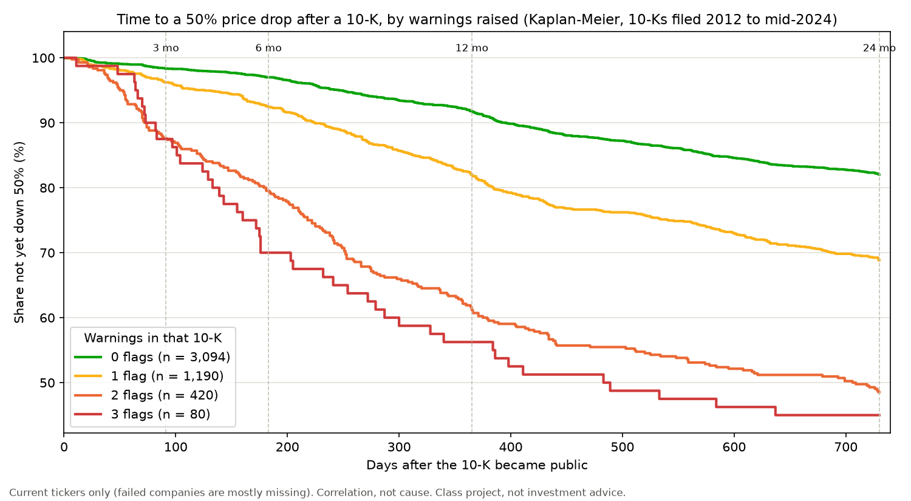
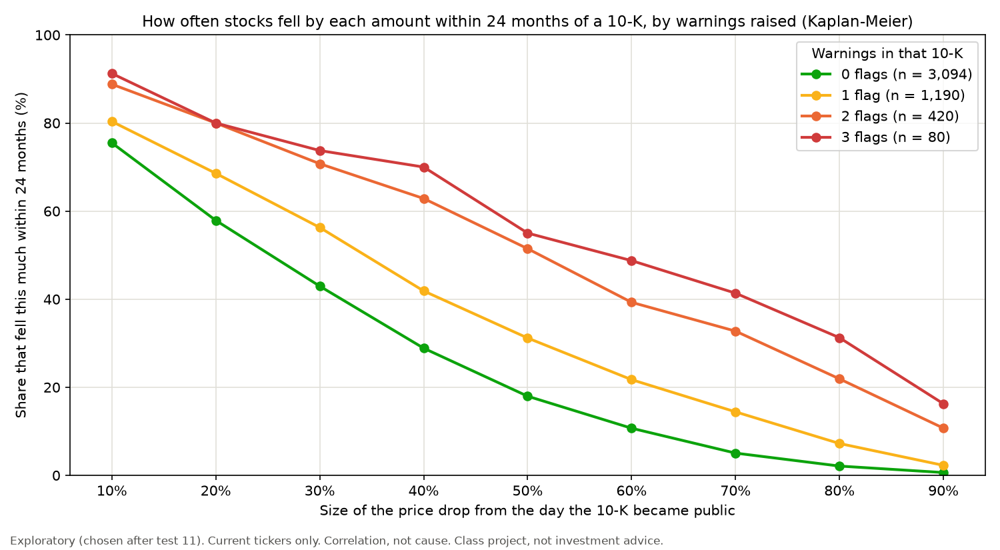

# Backtest: does the flag count predict stock returns?

**This is an analysis for a class project (AC 547), not investment
advice.** It tests whether the Earnings Quality Radar's warning count
lined up with later stock returns over 2021 to 2026. It does not show
that the flags cause returns, and its biases (below) are large enough
that the results should not be used to trade.

Reproduce: `python -m src.scores.backtest` (about a minute; reads
`data/processed/` and runs both windows in `config.BACKTEST_WINDOWS`,
2021-2025 as specified and 2014-2025). Code: `src/scores/backtest.py`; tests with a
hand-checked example: `tests/test_backtest.py`; settings:
`config.py` ("Long-short backtest"). Results:
`data/processed/backtest_results.parquet` (columns in
`docs/data_dictionary.md`) and `data/logs/backtest_*.csv`. Figures below
come from the run on 2026-11-19 with prices through 2026-11-10.

## Method

| Choice | Rule | Why |
| --- | --- | --- |
| Formation dates | June 30 of 2021 to 2025; trades on the last trading day on or before June 30 (2024-06-28 in 2024) | By June 30 nearly all December fiscal-year 10-Ks are public |
| Information used | Each company's latest score whose 10-K `filed_date` (from `financials_annual`) is strictly before the trade date, and at most 15 months old | Nothing filed on or after the trade date is used; an old score from a company that stopped filing is not used |
| Long leg | `flags_raised` = 0 | As specified |
| Short leg | `flags_raised` = 3 (M-Score above -1.78, Z'' distress zone and F-Score weak band) | As specified |
| Long leg variant | `all_three_scores`: 0 flags **and** an M-Score, a Z'' and an F-Score all exist | `flags_raised` counts a missing score as "no warning", so a company with only a safe Z'' has 0 flags. A 3 always needs all three scores, so the variant holds both legs to the same evidence standard |
| Long leg variant | `best_scores`: every check at its best: M-Score not flagged, Z'' safe (above 2.60) and F-Score strong (7 to 9) | 0 flags still allows a grey-zone Z'' and a middle F-Score; this asks for the best reading of all three. Added 2026-11-19 at the team's request |
| Sell on a flag (long only) | `long_only_sell_on_flag`: a long is sold at the close of the first trading day after a newer 10-K, filed during the holding year, raises any warning (`flags_raised` >= 1); the money waits in cash until the next June 30 | The first day an investor could act on the filing. A 10-K that is merely less than best (say an F-Score falling from 7 to 6) raises no flag, so the stock is held. Its exit trading cost is charged on the period's last day (same amount, slightly different timing in the daily path) |
| Eligibility | A current SEC ticker; a price on each of the last 20 trading days; adjusted close of at least $5 | Penny stocks are hard to short |
| Sizing | $100,000: $50,000 long and $50,000 short, equal-weighted within each leg | Dollar neutral |
| Holding | Buy and hold until the next formation date, then sell everything and rebuild the portfolio (50/50 again); the final period runs to the last SPY price (2026-11-10, about 16 months) | As specified |
| Prices | Adjusted close (dividends and splits included) | As specified |
| Delisting | A stock whose prices stop is exited at its last real price; the money then earns nothing | No price is ever invented |
| Costs | 0 or 20 bps on every dollar traded (entry and exit, even for a stock held in both periods, which overstates costs slightly); 1% a year on the short leg's starting value, pro-rated by days, at **both** cost levels | A short seller always pays to borrow |
| Benchmark | $100,000 in SPY bought 2021-06-30 and held to 2026-11-10, no costs | As specified |
| Each leg alone | $100,000 fully long, or fully short, in the same stocks | Comparable with SPY's $100,000 |
| Empty leg | A leg with no eligible stocks holds cash: no trading cost and no borrowing fee | Cash is neither traded nor borrowed |
| Wiped out | If the account's value reaches 0 or below (shorts owing more than everything it holds), it is closed: the value stays at 0 and later periods hold nothing | A broker would close the account; a negative balance is never compounded. No portfolio in the 2021-2025 run was wiped out |

## Results

### Ending value of $100,000 (2021-06-30 to 2026-11-10)

| Portfolio | 0 bps | 20 bps + borrow | Total return (20 bps) | Annualized (20 bps) | Max drawdown (20 bps) |
| --- | --- | --- | --- | --- | --- |
| Strategy, as specified | $207,881 | $204,459 | +104.5% | 14.3% | -32.8% |
| Strategy, all three scores | $212,299 | $208,814 | +108.8% | 14.7% | -31.0% |
| Long leg alone, as specified | $129,635 | $127,112 | +27.1% | 4.6% | -27.8% |
| Long leg alone, all three scores | $135,167 | $132,547 | +32.5% | 5.4% | -28.6% |
| Strategy, best scores | $227,726 | $224,014 | +124.0% | 16.2% | -30.3% |
| Long only, best scores, held | $155,944 | $152,962 | +53.0% | 8.2% | -29.2% |
| Long only, best scores, sold on a flag | $157,025 | $154,027 | +54.0% | 8.4% | -26.9% |
| Short leg alone | $276,788 | $272,621 | +172.6% | 20.6% | -89.7% |
| SPY | $187,909 | (no costs) | +87.9% | 12.5% | -24.5% |

The "0 bps" column still includes the 1% borrowing fee. Over the five
periods the strategy (as specified, 20 bps) paid $2,456 in trading costs
and $3,515 in borrowing fees. The short leg is the same in every
variant. Long-only portfolios pay no borrowing fee.

Max drawdown is the largest fall from a previous high in the daily
value. Long legs and SPY bottomed in the 2022 bear market (late
September to mid-October 2022). The strategy and the short leg bottomed on 2026-06-30, when two
2025 shorts had surged: FuelCell (FCEL) traded at 6.4 times its entry
price and Applied Digital (APLD) at 3.7 times. The eight shorts then
owed about 1.9 times the short leg's equity, so the short-only portfolio
fell to about $28,000 before those stocks dropped back. A broker would
have demanded more collateral or closed the positions well before that,
which this backtest does not model (see Limitations).

### Return by year (20 bps + borrow)

Each period runs from one formation date to the next; 2025 runs to
2026-11-10.

| Portfolio | 2021-22 | 2022-23 | 2023-24 | 2024-25 | 2025-26 |
| --- | --- | --- | --- | --- | --- |
| Strategy, as specified | +15.9% | -3.1% | +26.7% | +19.7% | +20.1% |
| Strategy, all three scores | +16.3% | -0.9% | +27.8% | +19.3% | +18.7% |
| Long leg alone, as specified | -20.9% | +14.6% | +6.8% | +3.3% | +27.2% |
| Long leg alone, all three scores | -20.0% | +19.1% | +9.1% | +2.5% | +24.4% |
| Short leg alone | +52.7% | -20.8% | +46.6% | +36.1% | +13.1% |
| SPY | -10.6% | +19.4% | +24.5% | +14.9% | +23.0% |

### Stocks in each leg and hit rates

A long "hits" if its return beat SPY's over the same period; a short
hits if its return was below SPY's. A tie is not a hit. For a delisted
stock the return runs to its exit price.

| Formation | Longs, as specified | Longs, all three scores | Shorts | Longs beating SPY (as specified / all three) | Shorts lagging SPY |
| --- | --- | --- | --- | --- | --- |
| 2021 | 1,074 | 289 | 7 | 36.0% / 34.3% | 7 of 7 |
| 2022 | 1,190 | 307 | 10 | 41.2% / 47.2% | 6 of 10 |
| 2023 | 1,141 | 302 | 10 | 27.3% / 27.8% | 9 of 10 |
| 2024 | 1,149 | 331 | 11 | 33.0% / 32.0% | 9 of 11 |
| 2025 | 1,155 | 320 | 8 | 45.0% / 46.6% | 6 of 8 |
| All | 5,709 | 1,549 | 46 | 36.6% / 37.6% | 37 of 46 (80.4%) |

### What the numbers say

- The strategy beat SPY (14.3% vs 12.5% a year after costs), but
  **almost all of the gain came from the short leg**. The long leg alone
  trailed SPY by about 8 points a year, and most 0-flag stocks
  underperformed SPY in every year. Equal-weighted portfolios of many
  smaller companies lagged a large-company index over this period, so
  this comparison mixes the flags with a size effect.
- The 3-flag stocks did badly: the median short lost between about 10%
  and 66% in each period, and 80% lagged SPY. But the short leg's returns
  rest on 7 to 11 stocks a year and swing widely: in 2022-23
  TransMedics (+167%), Blue Bird (+144%) and Norwegian Cruise Line
  (+96%) rose sharply and the short leg lost 21%.
- The stricter long leg (all three scores) did slightly better than the
  one as specified in total, but only in three of the five years, so the
  difference is small and not consistent.

## Long only: best indicators, sold on a flag

No shorting: $100,000 goes into the companies whose three checks are all
at their best (`best_scores`), equal-weighted, and is rebuilt each June
30. The second row also sells a stock as soon as a newer 10-K raises a
warning. 20 bps, no borrowing fee.

| Formation | Stocks bought | Sold after a flag | Held for the year | Sold on a flag | SPY |
| --- | --- | --- | --- | --- | --- |
| 2021 | 45 | 6 | -18.0% | -15.9% | -10.6% |
| 2022 | 90 | 17 | +25.6% | +24.9% | +19.4% |
| 2023 | 61 | 4 | +12.0% | +10.0% | +24.5% |
| 2024 | 88 | 9 | +5.4% | +5.0% | +14.9% |
| 2025 | 78 | 4 | +25.8% | +27.0% | +23.0% |

Best-indicator candidates over the five years: 362 traded; not traded,
147 with a stale score, 53 with no ticker, 5 with a gap in the last 20
trading days, 10 under $5 and 1 with no prices
(`data/logs/backtest_candidates.csv`).

- **Choosing the best indicators helped.** The best-scores long leg
  returned 8.2% a year against 4.6% for the 0-flag long leg, and beat
  SPY in two of five years (2022 and 2025). It still trailed SPY
  (12.5%) by about 4 points a year. 39.0% of its picks beat SPY.
- **Selling on a flag changed little.** It added 0.1 points a year and
  reduced the worst drop from -29.2% to -26.9%. 40 of 362 positions
  were sold early. The typical sold stock did better sold than held
  (median +1.6% against -10.0% to the rebalance), but a few sold stocks
  rallied afterward, so on average holding would have earned slightly
  more (+6.8% against +5.8%). In the 0-flag long leg (759 of 5,709
  sold) selling helped on both measures; in the all-three-scores leg
  (270 of 1,549) it helped the median but not the mean.
- **One sale checked by hand.** AMD was bought on 2022-06-30 on its
  FY2021 10-K (all three checks at their best). Its FY2022 10-K, filed
  2023-02-27, raised an M-Score flag (likely reflecting the Xilinx
  acquisition, which changes many of the M-Score's year-over-year
  ratios). It was sold on 2023-02-28 at $78.58 against a $76.47 entry,
  +2.76%.
- The best-scores strategy (best longs, 3-flag shorts) earned 16.2% a
  year, the highest of the long-short versions, but its edge over SPY
  still comes mainly from the short leg and its biases.

## 12 years and a fairer comparison (2014-2025)

Added 2026-11-19. Five periods cannot separate skill from luck, and SPY
is a large-company index while every portfolio here weights companies
equally, so beating or trailing SPY partly measures company size. Two
changes address this:

- **Window `2014_2025`:** the same rules on every June 30 from 2014 to
  2025, 12 periods. 2013 is left out because FY2012 has no F-Score (it
  needs a FY2010 row, which the pipeline does not keep), so a June 2013
  portfolio could hold no best-score or 3-flag companies.
- **Comparison group (`universe`, `equal_weight`):** every company whose
  latest score is usable on the trade date and that passes the same
  price checks, whatever its flags, equal-weighted and rebuilt each June
  30 (1,177 to 1,992 companies a year). A selection that beats this
  group picked better stocks than the pool it came from.

`data/logs/backtest_comparison.csv` compares each portfolio's yearly
returns with the group and with SPY. The t-statistic is the mean yearly
difference divided by its standard error; with 12 years it needs to be
about 2.2 or more before a difference is unlikely to be chance (about
2.8 with 5 years).

| Portfolio, 2014-06-30 to 2026-11-10, 20 bps | Per year | Worst drop | $100,000 becomes | Mean yearly edge over the group | Years ahead of the group | t |
| --- | --- | --- | --- | --- | --- | --- |
| SPY | 13.3% | -33.7% | $469,770 | | | |
| Best scores, long only, held | 11.6% | -38.3% | $388,382 | +2.1 pts | 8 of 12 | 1.0 |
| All three scores, long only | 11.3% | -38.2% | $374,881 | +1.9 pts | 8 of 12 | 1.8 |
| Best scores, long only, sold on a flag | 11.0% | -35.8% | $362,308 | +1.3 pts | 8 of 12 | 0.5 |
| 0 flags, long only | 9.3% | -40.0% | $299,249 | 0.0 pts | 8 of 12 | 0.0 |
| **Comparison group** | 9.0% | -40.4% | $291,789 | | | |
| Long-short strategy, as specified | 6.3% | -66.7% | $214,062 | -3.4 pts | 6 of 12 | -0.3 |
| Short leg alone (every variant) | wiped out in 2020-21 | -100% | $0 | | | |

What this shows:

- **Most of the gap to SPY is the stock pool, not the checks.** The
  comparison group trailed SPY by 3.2 points a year and beat it in 4 of
  12 years.
- **The checks may add about 2 points a year over comparable stocks,**
  but the evidence is weak: requiring all three scores, or the best
  readings, beat the group in 8 of 12 years, with t-statistics of 1.0
  to 1.8. "0 flags" alone (which counts a missing score as no warning)
  added nothing. In 2021-2025 alone the best-scores long leg beat the
  group in all 5 years (t = 2.4), but over 12 years the edge is much
  smaller, so the short window flattered it.
- **No long-only version beat SPY.** The best-scores long leg trailed
  it by 1.1 points a year (6 of 12 years ahead).
- **Selling on a flag cost return over 12 years** (about 0.6 points a
  year for best scores), while making the worst drop slightly smaller.
- **Shorting failed.** In 2020-21, 9 of the 12 shorts rose (Senseonics
  +885%), so the short-only portfolio lost everything and the long-short
  strategy fell 67% from its peak. Accounts that reach zero are closed
  at zero, not carried negative (see Method).
- **The bias is worse in early years.** Among companies with a usable
  score, 56% had no current ticker in 2014 against 13% in 2025, so early
  years cover mostly survivors, in both the selections and the
  comparison group (`data/logs/backtest_universe_status.csv`).

## Test register

Every additional test on the same years raises the chance that a
"winning" version is luck. This register lists every test run, in
order, and whether it was chosen before or after seeing earlier results.
New tests are written here and committed **before** they are run, and
every registered test is reported, whatever it shows.

| # | Test | Chosen | Status |
| --- | --- | --- | --- |
| 1 | Long-short, 0 flags vs 3 flags, 2021-2025, as specified | Before any result | Reported above |
| 2 | Long leg requiring all three scores | Before any result (planned with test 1) | Reported above |
| 3 | Long only, best scores | After seeing test 1 | Reported above; exploratory |
| 4 | Selling a long on a flag | After seeing test 1 | Reported above; exploratory |
| 5 | Formation from 2013 (scratch run) | After seeing tests 1-4 | Dropped: FY2012 has no F-Score, so 2013 could not be tested; replaced by 2014 |
| 6 | 2014-2025 window and the equal-weighted comparison group | After seeing tests 1-4 | Reported above |
| 7 | Value tilt, tests V1 to V3 below | Registered 2026-11-19, before any value-portfolio return was computed | Run twice: first with unchecked floats, then (final) with data fixes 9a and 9b; no registered test passed either time |
| 8 | Best-score value stocks (V3) against the whole value group (V1) | After seeing test 7 | Exploratory: t = 2.20 in the first run, 1.63 after the data fixes |
| 9 | Large companies minus red flags, tests L1 and L2 below | Registered 2026-11-19 after tests 1-8 (all years already seen), before any test-9 return was computed | Final run after data fixes 9a and 9b; no registered test passed |
| 9a | Data fix: public-float plausibility check (below), applied to tests 7 and 9 | Found while running test 9; set from the spread of float-to-price-x-shares and float-to-assets ratios, without looking at returns | Test 7 re-run and both versions reported; the first test-9 run is discarded (below) |
| 9b | Data fix: assets limit tightened from 1,000 to 100 times (below) | Found in the second test-9 run: SeaWorld's FY2019-22 floats, about 1,000 times too large, still passed and took 7.3% of the 2020 pool; set from the float-to-assets spread, without looking at returns | Tests 7 and 9 re-run with it; only this final run is reported |
| 10 | Do flagged companies blow up more often? Questions (a) and (b) below | Registered 2026-11-19 before any test-10 result was computed; all years already seen in earlier tests, so this is supporting evidence, not confirmation | Run 2026-11-19: (a) passed (t = 6.57); (b) did not (t = 1.76) |
| 11 | After a 10-K becomes public, how fast do stocks fall 50%, by flag count? Question (a) below | Registered 2026-11-19 before any test-11 result was computed; all years already seen in earlier tests, so this is supporting evidence, not confirmation | Run 2026-11-19: (a) passed (log-rank p = 6.4 x 10^-56, Flagged faster) |
| 11a | Method change: scipy instead of lifelines for test 11 (below) | Made 2026-11-19 before any test-11 result was computed, because lifelines cannot be installed with the project's pandas | Definitions unchanged |
| 12 | Test 11 repeated for drops of 10% to 90% (below) | Registered 2026-11-19 after seeing test 11, before any test-12 result was computed | Run 2026-11-19 (exploratory): Flagged fell faster at every drop size, all nine log-rank p-values below the Bonferroni bar |
| 13 | Do quarterly (TTM) flags predict blowups, and do they add anything beyond the annual flags? Questions (a) and (b) below | Registered 2026-11-22 before any test-13 result was computed. Quarterly flags are new, but the years and outcomes were already studied with annual flags in tests 10 to 12, so this is supporting evidence | Run 2026-11-22: (a) passed (t = 11.56); (b) passed (t = 6.47, with annual-Flagged also significant, t = 6.09) |
| 13a | Wording fix: test 13's entry rule (below) | Made 2026-11-22 before any test-13 result was computed: the registered entry is the first trading day strictly after `available_date`, as specified; the entry had wrongly called this "test 11's start rule" (test 11 starts on or after the filing date) | Definition unchanged |
| 14 | Does excluding flagged companies from a large-company portfolio reduce blowups and drawdowns without hurting returns? Questions (a) and (b) below | Registered 2026-11-23 before any test-14 result was computed; years already studied in tests 1 to 13, so supporting evidence | Run 2026-11-23: (a) passed (t = -5.18, lower blowup exposure); (b) no return difference found (t = -1.06; 95% interval -0.29 to +0.09 points a quarter) |
| 15 | Does excluding flagged stocks matter more in a concentrated (20-stock) portfolio? Question (a) below | Registered 2026-11-23 before any test-15 result was computed; years already studied in tests 1 to 14, so supporting evidence | Not yet run |

Tests 3, 4 and 6 were chosen after seeing results, so they are
exploratory: they suggest ideas but cannot confirm them.

### Test 7: value tilt (registered before running)

Background: Piotroski (2000) applied the F-Score to high book-to-market
("value") companies and reported its strongest results there. Our
portfolios ignore price, so this tests whether the checks add more
within value stocks. Verify the paper's details against the original
before citing them.

- **Value measure.** Book-to-market = `stockholders_equity` from the
  10-K behind the company's latest score (the `financials_annual` row)
  divided by that same 10-K's cover-page public float
  (`dei:EntityPublicFloat`: the market value of shares held by
  non-insiders on the last day of the second fiscal quarter). The float
  is read from `data/raw/companyfacts.zip` and matched by accession
  number, so it is known when the 10-K is filed and traces to the
  filing. Adjusted prices are not used, because they are scaled for
  later splits and dividends and would use future information.
  Companies with book equity of zero or less, or no public float in
  that 10-K, get no value rank and are counted.
- **Value group.** On each formation date, the fifth (quintile) of the
  comparison group with the highest book-to-market, among companies
  that have one.
- **Portfolios** (long only, equal-weighted, held to the next June 30,
  20 bps, same eligibility rules):
  - V1 `value`: every company in the value group (the control);
  - V2 `value_strong_f`: value group and F-Score strong (7 to 9; the
    team's band, not Piotroski's 8 to 9, to avoid tuning a cutoff);
  - V3 `value_best`: value group and best scores (M-Score not flagged,
    Z'' safe, F-Score strong).
- **Questions and pass mark.** (a) Does V2 beat V1? This is Piotroski's
  question: does a strong F-Score pick better value stocks? (b) Do V2
  and V3 beat the comparison group and SPY? Evidence window: 2014-2025
  (12 years); 2021-2025 is reported but not used as evidence. A result
  counts as evidence only if the yearly-difference t-statistic is at
  least 2.2.
- **No tuning afterwards.** The quintile, the F band, the value measure
  and the window are fixed here. Any change after seeing results must be
  added to this register as a new, exploratory test.

### Test 7 results, first run (before data fixes 9a and 9b)

These results used every public float as reported. Test 9 later showed
that some floats are tagged at the wrong scale, so the final results
are in "Test 7 results, final run" below; this first run is kept so the
record is complete.

Data check, made before any value-portfolio return was computed: 98.5%
of scored company-years from FY2013 on have a public float. About 4% of
floats are dated outside the usual window (about 6 months before fiscal
year-end; some look like tagging errors in the date, such as AMD's FY2025
10-K, which dates its float 2024-06-28). They are used as reported,
because each comes from the 10-K itself, so none uses later information.
In the 2014-2025 comparison group, 16,530 company-years were ranked;
2,117 had book equity of zero or less, 318 a zero float and 258 no float
(`data/logs/backtest_value_ranks.csv`). The value group held 210 to 339
companies a year.

| 2014-06-30 to 2026-11-10, 20 bps | Stocks a year | Per year | Worst drop | $100,000 becomes |
| --- | --- | --- | --- | --- |
| SPY | | 13.3% | -33.7% | $469,770 |
| V3 value and best scores | 3 to 15 | 13.5% | -42.5% | $477,674 |
| V2 value and strong F-Score | 8 to 37 | 8.9% | -49.1% | $288,617 |
| V1 value group | 210 to 339 | 7.1% | -53.9% | $233,572 |
| Comparison group | 1,177 to 1,992 | 9.0% | -40.4% | $291,789 |

| Registered question (2014-2025, yearly differences) | Mean | Median | Years ahead | t | Passes (t >= 2.2)? |
| --- | --- | --- | --- | --- | --- |
| (a) V2 beats V1 | +5.2 pts | -0.6 pts | 6 of 12 | 0.73 | No |
| (b) V2 beats the comparison group | +4.2 pts | | 5 of 12 | 0.46 | No |
| (b) V2 beats SPY | +1.0 pts | | 2 of 12 | 0.09 | No |
| (b) V3 beats the comparison group | +5.8 pts | | 9 of 12 | 1.44 | No |
| (b) V3 beats SPY | +2.6 pts | | 5 of 12 | 0.39 | No |

What this shows:

- **No registered test passed.** A strong F-Score did not reliably pick
  better value stocks here, so this backtest does not reproduce
  Piotroski's (2000) main result. Our sample differs from his (recent
  years, current tickers only, the team's 7-to-9 band, public float
  instead of full market value), so this is not evidence against the
  paper.
- **One year drives the averages.** In 2020-21 the value portfolios rose
  91% (V1), 169% (V2) and 110% (V3). Without that year, V2 trailed the
  comparison group by 4.6 points a year (t = -1.95) and V3 led it by 2.5
  (t = 0.99). This is why the mean differences are large while the
  medians and years-ahead counts are not.
- **V3 matched SPY's return with much more risk.** It ended slightly
  ahead of SPY ($477,674 against $469,770) with a deeper worst drop
  (-42.5% against -33.7%), beat SPY in only 5 of 12 years, and held
  just 3 to 15 stocks a year, so a few companies decided each year.
- **Exploratory only (test 8):** V3 beat the whole value group in 9 of
  12 years (t = 2.20, mean +6.8 points). This comparison was not
  registered, and test 7 ran five comparisons, so one reaching the pass
  mark by chance is not surprising. Treat it as an idea for a new test
  on new data, not a finding.

### Test 7 results, final run (with data fixes 9a and 9b)

408 company-years in the 2014-2025 comparison group were left out of
the rankings for an implausible float (status `float_implausible`). The
value group held 205 to 329 companies a year.

| 2014-06-30 to 2026-11-10, 20 bps | Stocks a year | Per year | Worst drop | $100,000 becomes |
| --- | --- | --- | --- | --- |
| SPY | | 13.3% | -33.7% | $469,770 |
| V3 value and best scores | 4 to 15 | 12.5% | -42.5% | $427,830 |
| V2 value and strong F-Score | 8 to 37 | 9.5% | -47.7% | $306,259 |
| V1 value group | 205 to 329 | 8.1% | -53.8% | $261,089 |
| Comparison group | 1,177 to 1,992 | 9.0% | -40.4% | $291,789 |

| Registered question (2014-2025, yearly differences) | Mean | Median | Years ahead | t | Passes (t >= 2.2)? |
| --- | --- | --- | --- | --- | --- |
| (a) V2 beats V1 | +4.7 pts | -1.9 pts | 5 of 12 | 0.66 | No |
| (b) V2 beats the comparison group | +4.7 pts | -4.1 pts | 5 of 12 | 0.52 | No |
| (b) V2 beats SPY | +1.5 pts | -11.1 pts | 1 of 12 | 0.13 | No |
| (b) V3 beats the comparison group | +4.8 pts | +2.0 pts | 8 of 12 | 1.19 | No |
| (b) V3 beats SPY | +1.6 pts | -1.8 pts | 5 of 12 | 0.23 | No |

- The conclusion is unchanged: no registered test passed, and 2020-21
  drives the means (without it, V2 trailed V1 by 1.9 points a year).
- With clean floats V3 no longer matches SPY: 12.5% a year against
  13.3%.
- The exploratory test 8 (V3 against V1) falls from t = 2.20 to 1.63.
  The earlier borderline result partly rested on bad data.

### Test 9: large companies minus red flags (registered before running)

Background: over 2014-2025 the checks may have picked slightly better
stocks than comparable companies (test 6), but the equal-weighted pool
of mostly smaller companies trailed SPY by 3.2 points a year. This test
keeps a large-company, size-weighted pool like SPY's and only removes
the companies the checks flag, so any edge from the checks is not
swamped by company size. Every year in the window has been seen in
earlier tests, so even a pass is weaker evidence than a test on new
years.

- **Pool.** On each formation date, the 500 companies in the comparison
  group (eligible, latest score usable, ticker, price checks) with the
  largest public float from the 10-K behind their latest score.
  Companies with no float or a float of zero or less are left out and
  counted.
- **Weights.** Each stock's share of the portfolio at formation is its
  public float divided by the total of the stocks held, then held
  unchanged (buy and hold) to the next June 30, like an index between
  rebalances.
- **Portfolios** (long only, 20 bps, no borrowing fee):
  - L1 `large_500`: the whole pool (the control, our stand-in for the
    S&P 500 without banks, insurers and REITs);
  - L2 `large_500_no_flags`: the pool without any company whose latest
    score raises a warning (`flags_raised` of 1 or more). Companies with
    no flag count (no scores) stay in. The remaining stocks are
    re-weighted by float.
- **Questions and pass mark.** (a) Does L2 beat SPY? (b) Does L2 beat
  L1? Question (b) isolates the checks, because SPY also holds sectors
  our universe excludes. Evidence window 2014-2025, yearly differences,
  pass mark t >= 2.2; years ahead are reported. L1 against SPY is
  reported to show how well the pool stands in for SPY. 2021-2025 is
  reported but not used as evidence.
- **Fixed here:** 500 companies, public-float size and weights, "any
  warning" as the exclusion rule, 20 bps and the window.

**Data fix 9a (2026-11-19, before the clean test-9 run).** The first
test-9 run gave a "large-company" pool that did not track SPY at all
(+60.6% in 2018 against SPY's +10.1%). The cause: some 10-Ks tag the
public float at the wrong scale, by up to a million times. IQVIA's
FY2017 float is $1.2 x 10^16 (about $20 billion would be plausible) and
took 99.8% of the 2018 portfolio; Advanced Energy's FY2020 is $2.6 x
10^18; SolarEdge's FY2022 is $15.1. That run is discarded. From now on a
float is used only if it is within 100 times adjusted price x shares
outstanding (where both exist; wide because adjusted prices carry later
splits) and within 100 times total assets (1,000 times before fix 9b). Failing floats are not
corrected, only left out (status `float_implausible`). The same errors
can push a company into or out of test 7's value group, so test 7 is
re-run with the check, and both versions are reported.

**Data fix 9b (2026-11-19).** The second run still let through floats
tagged in thousands as if they were dollars: SeaWorld's FY2019-FY2022
floats ($0.7 to $2.6 trillion, against about $1-2 billion in other
years) sat just under the 1,000-times-assets limit and took 7.3% of the
2020 pool. Every float above 100 times total assets in the data is an
error of this kind (FuelCell FY2020 $426 billion, Accuray FY2024 $194
billion, Universal Display FY2023 $320 billion), and no genuine one
comes close, so the limit is now 100 times. The second run is discarded
like the first; the results below are from the final run.

### Test 9 results (final run, with data fixes 9a and 9b)

The pool's largest holding each year is Apple or Microsoft (4% to 10%),
as in SPY, so the size measure now behaves sensibly. The no-flags
version held 366 to 435 of the 500 companies.

| 2014-06-30 to 2026-11-10, 20 bps | Per year | Worst drop | $100,000 becomes |
| --- | --- | --- | --- |
| L1 500 largest, float-weighted (our S&P stand-in) | 13.5% | -33.7% | $478,942 |
| SPY | 13.3% | -33.7% | $469,770 |
| L2 500 largest without flagged companies | 13.2% | -33.0% | $462,129 |

| Question (2014-2025, yearly differences) | Mean | Median | Years ahead | t | Passes (t >= 2.2)? |
| --- | --- | --- | --- | --- | --- |
| (a) L2 beats SPY | -0.1 pts | -0.7 pts | 5 of 12 | -0.12 | No |
| (b) L2 beats L1 (the checks' own effect) | -0.4 pts | -0.4 pts | 3 of 12 | -1.21 | No |
| L1 against SPY (how good a stand-in) | +0.2 pts | -0.1 pts | 5 of 12 | 0.30 | (not a test) |

- **The pool is a good stand-in for SPY.** L1 stayed within 5
  points of SPY every year and ended 0.2 points a year ahead, even
  though it excludes banks, insurers and REITs.
- **Removing flagged large companies did not help.** L2 trailed L1 in 9
  of 12 years, by 0.4 points a year on average. The difference is not
  statistically reliable (t = -1.21), and its direction is against the
  checks. In 2021-2025 alone the result is the same (-0.3 points a year,
  2 of 5 years ahead).
- **So the most SPY-like use of the checks did not beat SPY.** It
  trailed by 0.1 points a year and was ahead in 5 of 12 years, which is
  what holding SPY with some noise looks like.

### Test 10: do flagged companies blow up more often? (registered before running)

Registered before any test-10 result was computed; all years already
seen in earlier tests, so this is supporting evidence, not confirmation.
The definitions below are fixed.

- **Windows.** Formation dates every June 30 from 2014 to 2025, with
  the existing trade-date rule (the last trading day on or before June
  30). Each holding window runs from that trade date to the next one;
  the 2025 window ends on the last trading day on or before 2026-06-30
  (not at the end of the price data, as in earlier tests).
- **Pool.** The existing comparison group: latest score usable and at
  most 15 months old, a current ticker, a price on each of the last 20
  trading days, and an adjusted close of at least $5 on the trade date.
- **Blowup.** The stock's adjusted close falls to 50% or less of its
  trade-date close on any trading day in the holding window.
- **Prices that stop mid-window** (no price anywhere in the data after
  the stock's last price in the window, which is before the window's
  end): a blowup if any real price in the window, including the last,
  was at or below 50%; otherwise "unknown". Unknowns are reported
  separately and left out of the main rate, never counted as
  non-blowups.
- **Groups.** Only companies whose latest score has an M-Score, a Z''
  and an F-Score, so a missing score never counts as "no warning":
  - Clean: `flags_raised` = 0;
  - Flagged: `flags_raised` of 1 or more;
  - also 0, 1, 2 and 3 flags separately, as a descriptive check of
    whether the rate rises with each flag (not a pass/fail test).
- **Blowup rate** for a group and year = blowups / (stocks - unknowns).
- **Registered questions** (yearly differences over 12 years, pass mark
  t >= 2.2; t = mean difference / its standard error, as in earlier
  tests):
  - (a) Comparison group: is Flagged's yearly blowup rate higher than
    Clean's? Report the mean and median of (Flagged rate - Clean rate),
    the years Flagged was higher, and t.
  - (b) Large companies: the same question inside the test-9
    `large_500` pool (the 500 largest by public float, with data fixes
    9a and 9b), to check that the result is not just small-company
    volatility.
- **Also reported (descriptive, not tests):** for each year and group,
  stocks, blowups, unknowns and the rate; the pooled 12-year rate for
  each group and the ratio of Flagged to Clean; and the whole pool's
  blowup share each year, as market context (the 2019-20 window
  includes the March 2020 crash, which raises every group's rate).
- **Limitations, stated in advance.**
  - Survivorship: tickers are current ones, so companies that blew up
    and then delisted are likely missing. Flagged companies are
    probably missing more often, which would make the test understate
    the difference.
  - Flagged companies are weaker and likely more volatile by
    construction; question (b) only partly controls for size.
  - Correlation, not cause. This is test 10 on years already studied,
    so even a pass is weaker evidence than a test on new years.
- **Outputs:** a "Test 10 results" section here, whatever the results;
  details in `data/logs/backtest_blowups.csv`.

### Test 10 results

Run with `python -m src.scores.blowups` (code: `src/scores/blowups.py`;
tests with a hand-checked example in `tests/test_backtest.py`). Details:
`data/logs/backtest_blowups.csv` (one row per pool, window and stock)
and `data/logs/backtest_blowup_rates.csv`. Years are formation years:
"2019" is the window from June 2019 to June 2020.

| Registered question (yearly Flagged rate - Clean rate, 12 years) | Mean | Median | Years Flagged higher | t | Passes (t >= 2.2)? |
| --- | --- | --- | --- | --- | --- |
| (a) Comparison group | +13.2 pts | +13.3 pts | 12 of 12 | 6.57 | **Yes** |
| (b) The 500 largest companies | +3.8 pts | +0.8 pts | 6 of 12 (3 tied at 0, 3 lower) | 1.76 | No |

**Pooled 12-year rates** (blowups / stocks with a known outcome):

| Group | Comparison group | Rate | 500 largest | Rate |
| --- | --- | --- | --- | --- |
| Clean (0 flags) | 315 of 3,411 | 9.2% | 42 of 1,123 | 3.7% |
| Flagged (1+ flags) | 455 of 1,896 | 24.0% | 32 of 379 | 8.4% |
| Ratio, Flagged / Clean | | 2.6 | | 2.3 |
| 1 flag | 252 of 1,341 | 18.8% | 25 of 329 | 7.6% |
| 2 flags | 166 of 471 | 35.2% | 7 of 45 | 15.6% |
| 3 flags | 37 of 84 | 44.0% | 0 of 5 | 0% |
| Whole pool (all stocks, grouped or not) | 2,963 of 19,223 | 15.4% | 353 of 6,000 | 5.9% |

**By year, comparison group** (blowups / stocks; rate):

| Year | Clean | Flagged | Difference | Whole pool |
| --- | --- | --- | --- | --- |
| 2014 | 7 / 211 (3.3%) | 10 / 71 (14.1%) | +10.8 pts | 6.8% |
| 2015 | 20 / 225 (8.9%) | 19 / 77 (24.7%) | +15.8 pts | 17.2% |
| 2016 | 2 / 233 (0.9%) | 10 / 101 (9.9%) | +9.0 pts | 3.7% |
| 2017 | 8 / 245 (3.3%) | 9 / 117 (7.7%) | +4.4 pts | 4.6% |
| 2018 | 21 / 320 (6.6%) | 24 / 135 (17.8%) | +11.2 pts | 11.1% |
| 2019 (March 2020 crash) | 83 / 331 (25.1%) | 55 / 147 (37.4%) | +12.3 pts | 36.5% |
| 2020 | 2 / 297 (0.7%) | 3 / 171 (1.8%) | +1.1 pts | 2.7% |
| 2021 | 45 / 289 (15.6%) | 92 / 218 (42.2%) | +26.6 pts | 28.7% |
| 2022 | 25 / 307 (8.1%) | 44 / 196 (22.4%) | +14.3 pts | 14.3% |
| 2023 | 25 / 302 (8.3%) | 77 / 251 (30.7%) | +22.4 pts | 18.1% |
| 2024 | 47 / 331 (14.2%) | 57 / 199 (28.6%) | +14.4 pts | 19.6% |
| 2025 | 30 / 320 (9.4%) | 55 / 213 (25.8%) | +16.4 pts | 13.4% |

**By year, 500 largest companies:**

| Year | Clean | Flagged | Difference | Whole pool |
| --- | --- | --- | --- | --- |
| 2014 | 1 / 80 (1.3%) | 0 / 19 (0%) | -1.3 pts | 2.8% |
| 2015 | 4 / 83 (4.8%) | 1 / 22 (4.5%) | -0.3 pts | 10.4% |
| 2016 | 0 / 89 (0%) | 0 / 26 (0%) | 0 | 0.8% |
| 2017 | 0 / 89 (0%) | 0 / 25 (0%) | 0 | 0.8% |
| 2018 | 2 / 107 (1.9%) | 1 / 29 (3.4%) | +1.6 pts | 4.0% |
| 2019 (March 2020 crash) | 12 / 106 (11.3%) | 5 / 35 (14.3%) | +3.0 pts | 22.0% |
| 2020 | 0 / 102 (0%) | 0 / 40 (0%) | 0 | 0.4% |
| 2021 | 7 / 97 (7.2%) | 13 / 40 (32.5%) | +25.3 pts | 12.8% |
| 2022 | 4 / 94 (4.3%) | 1 / 39 (2.6%) | -1.7 pts | 3.2% |
| 2023 | 3 / 94 (3.2%) | 4 / 39 (10.3%) | +7.1 pts | 2.8% |
| 2024 | 5 / 95 (5.3%) | 3 / 31 (9.7%) | +4.4 pts | 4.0% |
| 2025 | 4 / 87 (4.6%) | 4 / 34 (11.8%) | +7.2 pts | 6.6% |

What this shows:

- **In the comparison group, flagged companies blew up far more often,
  every year.** Over 12 years, 24.0% of flagged stocks fell to half
  their price or less within a year, against 9.2% of clean ones (2.6
  times as often), and the gap was positive in all 12 years (t = 6.57).
  The rate rose with each added flag: 9.2% (0), 18.8% (1), 35.2% (2),
  44.0% (3). It held in the March 2020 crash window, when every group's
  rate jumped.
- **Among the 500 largest companies the evidence is weak.** Flagged
  large companies blew up 8.4% of the time against 3.7% (2.3 times), but
  blowups are rare at this size, most years had few or none in either
  group, and one window (2021-22, +25 points) supplies most of the gap.
  Flagged was higher in only 6 of 12 years; the test does not pass. So
  this test cannot rule out that the comparison-group result mainly
  reflects smaller, more volatile companies.
- **The checks behave like risk flags, not return predictors.** This
  fits the earlier tests: flagged companies did not reliably earn lower
  returns (tests 1-9), but they fell by half much more often. Large
  falls can be offset by large rebounds in the same group (the 2020-21
  short squeeze in test 6).

Checks made after the run (not registered; they do not change the
result):

- **One-day price dips.** Yahoo's prices contain occasional one-day
  spikes. 159 of the 2,963 comparison-group blowups rest on a single
  day at or below 50%, split evenly between the groups (22 clean, 20
  flagged; 117 not grouped). Counting those as non-blowups, (a) still
  passes (+12.8 points, 12 of 12 years, t = 6.38) and (b) still does not
  (+3.5 points, t = 1.50).
- **Hand check.** Sarepta (SRPT), 2015 window: trade-date close $30.43,
  low $10.74 on 2016-02-08, ratio 0.3529, as logged.
- **No unknowns.** No stock's prices stopped mid-window, the same
  survivorship signal as the backtest's zero delistings: companies that
  failed have no current ticker, so they never entered the pool.

Limitations:

- **Survivorship.** Tickers are current ones, so companies that blew up
  and then delisted are largely missing (there were no unknowns at all).
  Flagged companies are probably missing more often, which would make
  this test understate the difference.
- **Coverage.** Only companies with all three scores are grouped: 28%
  of comparison-group stock-years and 25% of the large pool's. Clean and
  Flagged describe that minority, not every stock.
- **Weaker by construction.** Flagged companies include those in the Z''
  distress zone or with a weak F-Score, so a higher blowup rate is
  partly what the definitions predict. Question (b) only partly controls
  for size, and did not pass.
- **Correlation, not cause, and years already studied.** This is test 10
  on years seen in earlier tests, so even the passing result is
  supporting evidence, not confirmation. It would need new years to
  confirm.
- This is an analysis for a class project, not investment advice.

### Test 11: how fast do stocks fall 50% after a 10-K? (registered before running)

Registered before any test-11 result was computed; all years already
seen in earlier tests, so this is supporting evidence, not confirmation.
The definitions below are fixed.

- **Observations.** Every scored company-year whose original 10-K
  (`filed_date` in `financials_annual`, which holds only original
  10-Ks) was filed on or before 2024-06-30, and whose score has an
  M-Score, a Z'' and an F-Score, so a missing score never counts as "no
  warning". A company appears once for each such year.
- **Start.** The first market trading day (SPY's calendar, as in earlier
  tests) on or after the 10-K's filing date. Reference price = the
  stock's adjusted close that day.
- **Eligibility at the start** (the same checks as earlier tests): a
  current ticker; a price on each of the 20 trading days ending on the
  start day; and an adjusted close of at least $5 on the start day.
- **Event.** The first trading day after the start on which the
  adjusted close is at or below 50% of the reference price. Time to the
  event is counted in calendar days from the start.
- **Follow-up and censoring.** Follow-up ends on the last trading day on
  or before the start plus 24 months. A stock that never reaches 50% by
  then is "censored" at that day. A stock whose prices stop earlier (no
  price anywhere in the data after its last one) is censored at its
  last price day, unless it had already reached 50%. "Censored" means
  we know only that the drop had not happened by that day, not that it
  never would.
- **Groups.** 0, 1, 2 and 3 flags (`flags_raised`), and Clean (0) vs
  Flagged (1 or more).
- **Method.** Kaplan-Meier survival curves by group, from the `lifelines`
  package (version pinned in `requirements.txt`). A survival curve shows,
  for each day after the start, the estimated share of stocks that have
  *not yet* fallen 50%. Kaplan-Meier uses every stock for as long as it
  was observed: a censored stock counts as "not yet dropped" up to its
  censoring day and then leaves the calculation, rather than being
  wrongly counted as never dropping.
- **Registered question (pass mark p < 0.01):** (a) Do Flagged stocks
  reach a 50% drop faster than Clean stocks? Log-rank test (two-sided,
  `lifelines.statistics.logrank_test`) of Flagged vs Clean. It passes
  only if p < 0.01 and Flagged had more drops than expected if the two
  groups were alike (the direction the question asks).
- **Also reported (descriptive, not tests):** the four tiers' curves on
  one chart; for each tier, the Kaplan-Meier estimate of the percent
  that had dropped 50% by 3, 6, 12 and 24 months (days 91, 183, 365 and
  730); and the median days to the drop, labeled "only among stocks
  that dropped".
- **Limitations, stated in advance.**
  - Survivorship: current tickers only, so companies that crashed and
    delisted are mostly missing; this likely understates the gap.
  - One company appears in several years, and its follow-up windows
    overlap, so observations are not fully independent and the
    log-rank p-value is too optimistic.
  - Flagged companies are weaker by construction; correlation, not
    cause; years already studied.
- **Outputs:** a "Test 11 results" section here, whatever the results;
  the chart as `docs/screenshots/test11_survival.png`; details in
  `data/logs/backtest_time_to_drop.csv`.

**Method change 11a (2026-11-19, before any test-11 result was
computed).** `lifelines` 0.30.3, its latest version, requires pandas
below 3.0, and the project pins pandas 3.0.6, so installing it would
break the rest of the project (the attempt downgraded pandas and was
undone). Test 11 therefore uses scipy, pinned in `requirements.txt`:
`scipy.stats.ecdf` on censored data for the Kaplan-Meier curves and
`scipy.stats.logrank` (two-sided) for question (a). These compute the
same statistics. Direction: scipy's log-rank statistic is positive when
the first group's drops come earlier, so (a) passes only if p < 0.01
and the statistic for Flagged (first) against Clean is positive. Every
other definition above is unchanged.

### Test 11 results

Run with `python -m src.scores.time_to_drop` (code:
`src/scores/time_to_drop.py`; tests with a hand-checked example in
`tests/test_backtest.py`). Details, one row per observation:
`data/logs/backtest_time_to_drop.csv`. Chart for the slides:
`docs/screenshots/test11_survival.png`.

**Who was observed.** 8,200 scored company-years with all three scores
and an original 10-K filed by 2024-06-30. 4,784 passed the eligibility
checks at the start (2,924 had no current ticker, 384 were under $5, 86
lacked 20 days of prices, 22 had no prices). The 4,784 observations come
from 872 companies (a median of 5 years each).

**Registered question (a): do Flagged stocks reach a 50% drop faster
than Clean stocks?** Log-rank test, Flagged (1,690 observations)
against Clean (3,094): statistic +15.75 (positive: Flagged's drops came
earlier), p = 6.4 x 10^-56. **Passes** (p < 0.01, in the direction
asked). Read the p-value with the limitation below: the observations are
not independent, so it is far too small, but even a much larger p-value
would pass.

How to read the chart: each curve starts at 100% on the day the 10-K
became public and steps down each time a stock in that group first
closes at half its starting price or less. A lower curve means more of
the group fell by half, sooner.

**Percent that had fallen 50%, by time since the 10-K** (Kaplan-Meier
estimates; because every censored stock was followed the full 24
months, which ends within a few days of day 730 depending on weekends
and leap years, these almost exactly equal the plain shares, e.g.
556 / 3,094 = 18.0%):

| Group | Observations | Drops | 3 months | 6 months | 12 months | 24 months | Median days to the drop, only among stocks that dropped |
| --- | --- | --- | --- | --- | --- | --- | --- |
| 0 flags (Clean) | 3,094 | 556 | 1.7% | 3.0% | 8.2% | 18.0% | 378 |
| 1 flag | 1,190 | 371 | 3.8% | 7.6% | 18.1% | 31.2% | 329 |
| 2 flags | 420 | 216 | 12.4% | 20.5% | 38.8% | 51.5% | 225 |
| 3 flags | 80 | 44 | 12.5% | 30.0% | 43.8% | 55.0% | 176 |
| Flagged (1 or more) | 1,690 | 631 | 6.3% | 11.8% | 24.4% | 37.3% | 271 |

The median days column describes only the stocks that did fall by half;
it is not how long a typical stock in the group took, because most
stocks in every group never dropped.

What this shows:

- **Flagged stocks fell by half more often and sooner.** Within 24
  months, 37.3% of Flagged observations had fallen 50% against 18.0% of
  Clean ones, and the gap is visible from the first months (6.3% against
  1.7% by 3 months).
- **The risk rises with each added flag.** 18.0% (0 flags), 31.2% (1),
  51.5% (2) and 55.0% (3) within 24 months. Among the stocks that
  dropped, the drop also came sooner with more flags (median 378 days
  with no flags, 176 with three). The 3-flag tier has only 80
  observations, so its curve is the least precise.
- **This agrees with test 10** (blowup rates by year) using a different
  method and a longer window: the checks flag a higher risk of a large
  fall, even though they did not reliably predict returns (tests 1-9).

Checks made after the run (not registered; they do not change the
result):

- **Hand check.** CVU, FY2018: 10-K filed 2019-04-01, which was the
  start day (close $6.53). The lowest close before the drop was 52.1% of
  that; on 2020-02-26 it closed at $3.18 (48.7%), day 331, as logged.
- **One-day touches.** 363 drops were followed the next day by a close
  back above 50% (187 Flagged, 176 Clean). This includes price glitches
  and also genuine stocks hovering at the line, so it is a strict check.
  Counting all of them as no drop, (a) still passes (statistic +13.60, p
  = 3.9 x 10^-42) and the tiers keep their order (12.7%, 23.1%, 40.4%,
  42.8% within 24 months).
- **No early censoring.** No observation's prices stopped within its 24
  months; every censored stock was followed the full period. This is the
  same survivorship signal as tests 9 and 10.

Limitations:

- **Survivorship.** Tickers are current ones: 2,924 of the 8,200
  candidate observations (36%) had no current ticker, and companies that
  crashed and delisted are mostly among them. Flagged companies are
  probably missing more often, so the gap is likely understated.
- **Observations are not independent.** The 4,784 observations come from
  872 companies, and one company's 24-month windows overlap from year to
  year, so the log-rank test treats repeated, related observations as
  separate evidence. Its p-value is too optimistic, possibly by many
  orders of magnitude. The direction and size of the gap, which hold in
  every tier and in the one-day check, matter more than the exact
  p-value.
- **Weaker by construction.** Flagged companies include those in the Z''
  distress zone or with a weak F-Score, so faster drops are partly what
  the definitions predict.
- **Correlation, not cause, and years already studied.** Even the
  passing result is supporting evidence, not confirmation; it would need
  new years to confirm.
- This is an analysis for a class project, not investment advice.

### Test 12: drops of 10% to 90% (registered before running; exploratory)

Registered after seeing test 11 and before any test-12 result was
computed. Because the idea came from test 11's result, this test is
exploratory: it describes whether the Flagged-Clean gap grows or shrinks
with the size of the drop, and cannot confirm anything on its own.

- **Definitions:** exactly test 11's (observations, start, eligibility,
  24-month follow-up, censoring, groups, Kaplan-Meier from scipy), with
  the event changed: the first trading day after the start on which the
  adjusted close is at or below (100% - d) of the start price, for each
  drop size d = 10%, 20%, 30%, 40%, 50%, 60%, 70%, 80% and 90%. The 50%
  row repeats test 11 and must match it.
- **Reported for each drop size:** for 0, 1, 2 and 3 flags, Clean and
  Flagged, the Kaplan-Meier percent that had reached the drop by 3, 6,
  12 and 24 months and the median days to it (only among stocks that
  reached it); and a two-sided log-rank test of Flagged against Clean.
- **Multiple tests:** nine log-rank tests are run, so each is compared
  with 0.01 / 9 = 0.0011 (a Bonferroni adjustment). Because the test is
  exploratory, a result below that bar is reported as a pattern, not as
  a confirmed finding.
- **Outputs:** a "Test 12 results" section here, whatever the results;
  a chart of drop size against the 24-month percent by tier,
  `docs/screenshots/test12_drop_sizes.png`; details in
  `data/logs/backtest_drop_sizes.csv`.
- **Limitations:** test 11's (survivorship, overlapping observations
  from the same companies so p-values are too optimistic, weaker by
  construction, correlation not cause, years already studied), plus:
  small drops such as 10% happen to most stocks in two years, so they
  say little about risk.

### Test 12 results (exploratory)

Run with `python -m src.scores.drop_sizes` (code:
`src/scores/drop_sizes.py`, which reuses test 11's functions; tests in
`tests/test_backtest.py`). Details: `data/logs/backtest_drop_sizes.csv`.
The same 4,784 eligible observations as test 11. The 50% row matches
test 11 exactly, as it must.

**Share that fell by each amount within 24 months** (Kaplan-Meier), with
the Flagged-Clean gap and the log-rank test (bar: p < 0.0011):

| Drop | 0 flags (Clean) | 1 flag | 2 flags | 3 flags | Flagged | Gap | Flagged / Clean | Log-rank statistic | p |
| --- | --- | --- | --- | --- | --- | --- | --- | --- | --- |
| 10% | 75.5% | 80.4% | 88.8% | 91.3% | 83.0% | +7.5 pts | 1.1x | +10.60 | 3.0e-26 |
| 20% | 57.9% | 68.6% | 80.0% | 80.0% | 72.0% | +14.1 pts | 1.2x | +12.71 | 5.2e-37 |
| 30% | 43.0% | 56.3% | 70.8% | 73.8% | 60.7% | +17.7 pts | 1.4x | +14.00 | 1.5e-44 |
| 40% | 28.9% | 41.9% | 62.9% | 70.0% | 48.4% | +19.5 pts | 1.7x | +14.90 | 3.1e-50 |
| 50% | 18.0% | 31.2% | 51.5% | 55.0% | 37.3% | +19.4 pts | 2.1x | +15.75 | 6.4e-56 |
| 60% | 10.7% | 21.7% | 39.3% | 48.8% | 27.4% | +16.7 pts | 2.6x | +15.48 | 4.5e-54 |
| 70% | 5.0% | 14.4% | 32.7% | 41.4% | 20.2% | +15.2 pts | 4.0x | +16.74 | 6.3e-63 |
| 80% | 2.1% | 7.2% | 21.9% | 31.2% | 12.0% | +9.9 pts | 5.7x | +14.42 | 3.6e-47 |
| 90% | 0.6% | 2.3% | 10.7% | 16.2% | 5.0% | +4.4 pts | 8.0x | +10.05 | 9.2e-24 |

The 3, 6 and 12-month percents and the median days to each drop (only
among stocks that reached it) are in the details file and the run
output.

What this shows (exploratory):

- **Flagged stocks fell faster at every drop size,** and the tiers keep
  their order (0 < 1 < 2 flags, with 3 flags highest or tied) at every
  size. All nine log-rank p-values are below the Bonferroni bar, but
  with the same caveat as test 11: the observations overlap, so the
  p-values are far too optimistic.
- **The bigger the drop, the more the warnings matter in relative
  terms.** A 10% fall within two years is common for everyone (75.5% of
  Clean, 83.0% of Flagged), so the flags add little there. For a 70%
  fall, Flagged stocks were 4 times as likely as Clean ones (20.2% vs
  5.0%), and for a 90% fall 8 times (5.0% vs 0.6%).
- **The absolute gap peaks at 40-50% drops** (about +19.5 points) and
  shrinks for the largest drops only because few stocks of any kind
  fall that far.
- **Small groups at the extremes.** At 90%, only 19 Clean and 85 Flagged
  observations dropped (13 of them in the 80-observation 3-flag tier),
  so those rows rest on few cases.
- Together with tests 10 and 11, this points the same way: the checks
  flag the risk of a large fall, and the larger the fall, the stronger
  the link. Because the test was chosen after test 11, treat this as a
  pattern worth testing on new years, not a confirmed finding.

Limitations: those of test 11 (survivorship, overlapping observations
from 872 companies, weaker by construction, correlation not cause,
years already studied), plus the small counts at 80-90% drops. This is
an analysis for a class project, not investment advice.

### Test 13: quarterly (TTM) flags and blowups (registered before running)

Registered before any test-13 result was computed. Quarterly flags are
new, but the years and outcomes were already studied with annual flags
in tests 10 to 12, so this is supporting evidence. The definitions below
are fixed; they reuse tests 10 and 11's code wherever a rule is the
same.

- **Observations.** Every company-quarter in `scores_quarterly` with an
  M-Score, a Z'' and an F-Score (all three present), whose
  `available_date` is from 2014-01-01 to 2025-10-31, so that every
  observation has a full 12-month follow-up in the price data.
- **Entry.** The first market trading day (SPY's calendar) strictly
  after `available_date` (see 13a): the first full trading day after the
  quarterly score became public.
- **Eligibility** (test 10's, `backtest.price_status` on the entry day):
  a current ticker; a price on each of the 20 market trading days
  through the entry day; and an adjusted close of at least $5 on the
  entry day. Ineligible observations are counted by reason.
- **Outcome.** Test 10's blowup: the adjusted close falls to 50% or less
  of the entry-day close on any trading day from entry to the last
  trading day on or before entry + 12 months. Prices that stop
  mid-window with no blowup are "unknown" (test 10's rule): counted and
  left out of every rate and model, never treated as non-blowups.
- **Quarterly flag status.** Quarterly-Clean: `flags_raised` = 0;
  quarterly-Flagged: 1 or more (all three scores are present by the
  observation rule).
- **Cohorts.** The calendar quarter of the entry date (for example
  2016-Q3), used as fixed effects.
- **Annual flag at the same date (point in time).** The company's
  latest annual `scores` row whose 10-K (`financials_annual`
  `filed_date`) was filed strictly before the entry date, using test
  10's rule (`backtest.latest_scores`): it is unusable if that 10-K was
  filed more than 15 months before entry (stale), or if any of the
  three annual scores is missing. Annual-Clean: 0 flags; annual-Flagged:
  1 or more. A 10-K filed on or after the entry date is never used.
- **Registered questions** (pass mark t >= 3.0 on the quarterly-Flagged
  coefficient, positive, because 2 questions are tested and the years
  were already studied):
  - (a) Replication: is the 12-month blowup rate higher for
    quarterly-Flagged than quarterly-Clean? A linear probability model
    (OLS) of blowup (1 or 0) on quarterly-Flagged with entry-cohort
    fixed effects; standard errors clustered by company.
  - (b) Beyond annual: among observations that also have a usable
    annual flag status, the same model with annual-Flagged added. Does
    quarterly-Flagged keep t >= 3.0 with annual-Flagged included?
- **Descriptive, not tests:**
  - observations, blowups, unknowns and the blowup rate by quarterly
    flag count (0, 1, 2 and 3), next to test 10's pooled annual rates
    by flag count;
  - a 2x2 table of annual flag status by quarterly flag status: count
    and blowup rate in each cell;
  - newly flagged (quarterly-Flagged now and quarterly-Clean in the
    company's previous fiscal quarter) vs persistently flagged
    (quarterly-Flagged now and in the same fiscal quarter one year
    earlier): count and blowup rate; the earlier quarter must have all
    three scores, or the observation is in neither group;
  - the median age of the flag at entry, annual vs quarterly: days from
    the end of the period the scores describe (annual: fiscal year end;
    quarterly: quarter end) to entry, and days from when the flag became
    public (annual: the 10-K's filing date; quarterly: `available_date`)
    to entry.
- **Limitations, stated in advance.**
  - Survivorship: tickers are current ones, so companies that blew up
    and delisted are likely missing, which would understate any
    difference.
  - Overlapping observations: a company appears up to four times a
    year, with overlapping 12-month windows, so observations are not
    independent; this is why standard errors are clustered by company
    and cohorts are fixed effects.
  - Quarterly coverage is lower than annual: requiring all three
    quarterly scores shrinks the sample, so every count is reported.
  - Quarterly data comes from unaudited 10-Q filings.
  - Correlation, not cause; the years were already studied, so even a
    pass is supporting evidence, not confirmation.
  - This is an analysis for a class project, not investment advice.
- **Outputs:** a "Test 13 results" section here, whatever the results;
  a chart of the blowup rate by quarterly flag count next to test 10's
  annual rates, `docs/screenshots/test13_blowups.png`; details in
  `data/logs/backtest_quarterly_blowups.csv`.

### Test 13 results

Run once, on 2026-11-22, with `python -m src.scores.quarterly_blowups`
(code: `src/scores/quarterly_blowups.py`; tests in
`tests/test_backtest.py`; details per observation in
`data/logs/backtest_quarterly_blowups.csv`).

**Observations.** 26,761 company-quarters had all three quarterly
scores and an `available_date` in the window. 15,968 were eligible on
the entry day (880 companies, 48 entry cohorts, 2014Q1 to 2025Q4); the
rest had no current ticker (8,998), a close under $5 (1,491), a missing
price in the 20 days before entry (244) or no prices (60). Outcomes:
2,260 blowups, 13,708 no blowup, 0 unknown. Test 10 also had no unknowns:
with current tickers only, prices almost never stop mid-window, which is
itself a sign of the survivorship limitation.

**Registered questions** (linear probability model, entry-cohort fixed
effects, standard errors clustered by company; pass: positive
coefficient with t >= 3.0):

| Question | Observations | Companies | Quarterly-Flagged coefficient | SE | t | Result |
| --- | --- | --- | --- | --- | --- | --- |
| (a) blowup ~ quarterly-Flagged | 15,968 | 880 | +0.141 | 0.012 | 11.56 | **Passed** |
| (b) blowup ~ quarterly-Flagged + annual-Flagged | 14,942 | 834 | +0.072 | 0.011 | 6.47 | **Passed** |

In (b) the annual-Flagged coefficient is +0.088 (t = 6.09): each flag
keeps its own association with blowups when the other is in the model.
(b) uses the 14,942 observations (94% of (a)) whose latest 10-K before
entry was at most 15 months old and had all three annual scores.

**By quarterly flag count** (descriptive), next to test 10's pooled
annual rates (June 30 portfolios, a different design, so the levels are
only roughly comparable):

| Flags | Quarterly observations | Blowups | Quarterly rate | Test 10 annual rate |
| --- | --- | --- | --- | --- |
| 0 | 9,883 | 846 | 8.6% | 9.2% |
| 1 | 4,289 | 779 | 18.2% | 18.8% |
| 2 | 1,542 | 527 | 34.2% | 35.2% |
| 3 | 254 | 108 | 42.5% | 44.0% |

The rate rises with each quarterly flag, as it did with annual flags:
quarterly-Flagged overall 23.2% against 8.6% for quarterly-Clean, about
2.7 times. Chart: `docs/screenshots/test13_blowups.png`.

**Annual by quarterly flag status** (observations with a usable annual
status; descriptive):

| | Quarterly-Clean | Quarterly-Flagged |
| --- | --- | --- |
| Annual-Clean | 8,372 obs, 7.7% | 966 obs, 13.9% |
| Annual-Flagged | 898 obs, 14.6% | 4,706 obs, 24.4% |

The two agree in 87.5% of observations (13,078 of 14,942). Where they
disagree, a flag from either source goes with a blowup rate 1.8 to
1.9 times that of a stock clean on both, and a stock flagged by both has the
highest rate.

**Newly vs persistently flagged** (descriptive):

| Group | Observations | Blowups | Rate |
| --- | --- | --- | --- |
| Newly flagged (clean the quarter before) | 869 | 127 | 14.6% |
| Persistently flagged (also flagged a year earlier) | 3,237 | 775 | 23.9% |
| of which both newly and persistently | 200 | 35 | 17.5% |
| Quarterly-Clean, for reference | 9,883 | 846 | 8.6% |

A new flag goes with a higher rate than no flag, but a lasting flag
goes with a much higher one. Observations whose earlier quarter lacked
any of the three scores are in neither group.

**Median age of the flag at entry** (descriptive):

| Basis | Observations | Days since the period ended | Days since the flag became public |
| --- | --- | --- | --- |
| Quarterly | 15,968 | 41 | 1 |
| Annual (same observations, usable status) | 14,942 | 131 | 76 |

At the moment a quarterly flag becomes usable, the latest annual flag
describes a period about three months older and has been public for
about two and a half months.

**What the numbers say.**
- Both registered questions passed. Quarterly flags go with more
  12-month blowups, at rates close to annual flags', and they keep
  their own association after the annual flag known on the same day
  is included.
- They are fresher than annual flags at entry, but most of the time
  they agree with them (87.5%), so they largely repeat the annual
  signal, earlier, rather than finding a different set of companies.
- A flag that lasts goes with more blowups than a new one.

**Limitations** (as registered): current tickers only (survivorship;
8,998 observations had no current ticker, and 0 unknown outcomes shows
how few delisted stocks remain); overlapping observations from the
same companies (clustered standard errors and cohort fixed effects
address this, but the effective sample is the 880 companies, not
15,968 observations); quarterly coverage is lower than annual
(requiring all three quarterly scores); unaudited 10-Q data; the years
were already studied with annual flags in tests 10 to 12, so this is
supporting evidence, not confirmation; correlation, not cause. This is
an analysis for a class project, not investment advice.

### Test 14: large companies without flagged stocks, quarterly (registered before running)

Registered before any test-14 result was computed; years already studied
in tests 1 to 13, so supporting evidence. The definitions below are
fixed.

- **Rebalance dates.** The end of each calendar quarter from 2013-12-31
  to 2025-09-30 (48 dates); trades on the last trading day on or before
  each date (`backtest.holding_periods`), so the portfolios are held
  through the 48 calendar quarters 2014Q1 to 2025Q4. The last holding
  period ends on the last trading day on or before 2025-12-31.
- **Base portfolio.** On each rebalance date, the test-9 `large_500`
  pool, built by the same code (`backtest.universe_picks`,
  `book_to_market` with data fixes 9a and 9b, `large_cap_picks`): the
  500 companies in the comparison group (latest annual score usable, a
  current ticker, a price on each of the last 20 trading days, an
  adjusted close of at least $5) with the largest plausible public
  float. Unlike test 9, every portfolio here is **equal-weighted** over
  the stocks it holds.
- **Flags known at each rebalance (point in time).**
  - Annual: the company's latest annual score whose 10-K was filed
    strictly before the trade date and at most 15 months before it
    (`backtest.latest_scores`, the same row the pool uses); flagged if
    `flags_raised` >= 1.
  - Quarterly: the company's latest `scores_quarterly` row whose
    `available_date` is strictly before the trade date and at most 15
    months before it (the annual flag's age limit, so a company that
    stopped filing 10-Qs does not keep an old flag); flagged if
    `flags_raised` >= 1. The median age is reported.
  - A stock with no usable flag (no flag count, or no quarterly row)
    stays in.
- **Portfolios**, rebalanced on the same dates, equal-weighted over the
  stocks that remain:
  - Base: the `large_500` pool;
  - A: the pool minus stocks with an annual flag;
  - B: the pool minus stocks flagged by either the annual or the
    quarterly flag;
  - P (descriptive, **chosen after seeing test 13**, exploratory): the
    pool minus stocks persistently quarterly-flagged: the latest
    quarterly row flagged and the same company's quarter one year
    earlier (four fiscal quarters back) also flagged.
- **Simulation** (written for this test, because the earlier tests sell
  everything each period while this test charges actual turnover):
  $100,000 starting value; on each trade date the portfolio is reset to
  equal weights over its stocks, and between trade dates each position
  moves with its own adjusted close (buy and hold). A stock whose prices
  stop is exited at its last real price, and that money earns nothing
  until the next trade date (the earlier tests' rule). Nothing is ever
  invented.
- **Turnover and costs.** At each trade date, turnover = half the sum,
  over all stocks, of the absolute difference between the new target
  weight and the weight just before trading (each stock's drifted value
  over the portfolio's value; cash from an exited stock counts as a
  weight to be traded). The first date is a full purchase (turnover 1).
  Cost = c x (sum of absolute weight changes) x portfolio value, so
  every dollar bought or sold pays c; results at c = 0 and 10 basis
  points.
- **Measures, per portfolio, over 2014-01-02 to 2025-12-31.**
  Annualized return (geometric, from daily values); annualized
  volatility (standard deviation of daily returns x square root of
  252); maximum drawdown (largest fall from a previous peak in the
  daily value); return divided by volatility (no risk-free rate is
  subtracted, so this is not a Sharpe ratio); average quarterly
  turnover; and blowup exposure: each quarter, the share of the stocks
  held at the trade date whose adjusted close fell to 50% or less of
  the trade-date close on any trading day from the trade date to the
  last trading day on or before the holding quarter's end + 12 months
  (test 10's rule, `blowups.classify_window`; unknowns, if any, are
  counted and left out of the share).
- **Registered questions** (pass mark t >= 3.0 in absolute value, 2
  questions, years already studied):
  - (a) Does overlay B lower blowup exposure versus the base? Quarterly
    differences (B's share minus the base's share) for the 47 quarters
    2014Q1 to 2025Q3; t = mean difference / its standard error. Passes
    if the mean is negative and t <= -3.0. 2025Q4 is reported but not
    used, because its 12-month follow-up runs past the end of the price
    data (2026-11-10).
  - (b) Does overlay B change returns versus the base? Quarterly
    return differences (B minus base, after 10 bps), 48 quarters: the
    mean, its 95% confidence interval (t distribution, 47 degrees of
    freedom) and t. A difference is found only if |t| >= 3.0. Failing to
    find a difference does not prove there is none; the interval shows
    how large a difference the data can rule out.
- **Descriptive, not tests:** overlay A against B (what the quarterly
  flags add); overlay P, labeled exploratory (chosen after test 13);
  each portfolio's return and blowup exposure by calendar year,
  including 2020 and 2022; the number of stocks held and excluded each
  quarter; and the median age of the quarterly flags used.
- **Limitations, stated in advance.** Survivorship (current tickers
  only); years already studied in tests 1 to 13; equal weighting rather
  than index (float) weighting, so smaller members of the pool count as
  much as the largest; no risk-free rate; correlation, not cause; this
  is an analysis for a class project, not investment advice.
- **Outputs:** a "Test 14 results" section here, whatever the results;
  a chart of cumulative growth and drawdowns for the base and overlays A
  and B, `docs/screenshots/test14_overlay.png`; details in
  `data/logs/backtest_overlay_*.csv`.

### Test 14 results

Run once, on 2026-11-23, with `python -m src.scores.overlay` (code:
`src/scores/overlay.py`; tests in `tests/test_backtest.py`; details in
`data/logs/backtest_overlay_*.csv`).

**Portfolios.** The base held the 500 pool stocks every quarter.
Overlay A held 364 to 443 (median 394.5), overlay B 335 to 431 (median
379.5) and overlay P 408 to 468 (median 425). The quarterly flags used
were a median 58 days old at the rebalance. No outcome was unknown.

**Summary, 2014Q1 to 2025Q4** ($100,000 start; return/volatility has no
risk-free rate subtracted, so it is not a Sharpe ratio):

| Portfolio | Cost | Annualized return | Volatility | Max drawdown | Return / volatility | Turnover per quarter* | Ending value |
| --- | --- | --- | --- | --- | --- | --- | --- |
| Base | 0 bps | 11.03% | 18.46% | -38.4% | 0.60 | 7.4% | $351,447 |
| Base | 10 bps | 10.97% | 18.46% | -38.4% | 0.59 | 7.4% | $348,306 |
| A | 0 bps | 10.80% | 18.34% | -38.3% | 0.59 | 8.5% | $342,504 |
| A | 10 bps | 10.72% | 18.34% | -38.3% | 0.58 | 8.5% | $339,086 |
| B | 0 bps | 10.66% | 18.19% | -37.9% | 0.59 | 9.4% | $337,375 |
| B | 10 bps | 10.58% | 18.19% | -37.9% | 0.58 | 9.4% | $333,740 |
| P (exploratory) | 10 bps | 10.71% | 18.50% | -38.0% | 0.58 | 8.7% | $338,681 |

\* One-way turnover, averaged over the 47 rebalances after the first
purchase (including the first: base 9.4%, A 10.4%, B 11.3%).

**Registered questions** (pass mark |t| >= 3.0):

| Question | Quarters | Mean difference (B minus base) | t | Result |
| --- | --- | --- | --- | --- |
| (a) Blowup exposure | 47 (2014Q1 to 2025Q3) | -1.21 points (6.14% against 7.35%) | -5.18 | **Passed**: B lower in 40 quarters, higher in 6 |
| (b) Quarterly return, after 10 bps | 48 | -0.10 points a quarter; 95% interval -0.29 to +0.09 | -1.06 | **No difference found** |

For (b), failing to find a difference does not prove there is none.
The interval shows what the data can rule out: a quarterly cost of more
than about 0.29 points (about 1.2 points a year), or a gain of more than
about 0.09 points (about 0.4 points a year). The point estimate is a
small cost (about 0.4 points a year), and over the 12 years B ended at
$333,740 against the base's $348,306.

2025Q4 is left out of (a), as registered, because its 12-month
follow-up runs past the end of the price data.

**What the quarterly flags add** (descriptive, B against A): blowup
exposure 0.19 points lower (t = -3.45 on the quarterly differences),
and quarterly returns 0.05 points lower (t = -1.17; 95% interval -0.13
to +0.03). Most of the blowup reduction comes from the annual flags
(A: 6.33% against the base's 7.35%); the quarterly flags trim a little
more.

**Overlay P** (exploratory, chosen after test 13): excluding only
persistent quarterly flags cut blowup exposure less than A or B (6.90%,
against the base's 7.35%) and returned about the same as A (10.71% a
year against 10.72%).

**By calendar year** (returns after 10 bps; blowup exposure is the mean
of each year's quarters):

| Year | Base | A | B | P | Base blowup | B blowup |
| --- | --- | --- | --- | --- | --- | --- |
| 2014 | 12.1% | 10.3% | 10.3% | 10.6% | 5.2% | 5.1% |
| 2015 | -5.1% | -5.8% | -5.8% | -5.3% | 9.3% | 8.2% |
| 2016 | 17.0% | 16.6% | 16.7% | 17.4% | 2.1% | 1.5% |
| 2017 | 22.8% | 23.1% | 22.1% | 22.6% | 1.9% | 1.5% |
| 2018 | -6.7% | -7.8% | -7.6% | -7.8% | 5.3% | 5.1% |
| 2019 | 31.2% | 31.2% | 30.5% | 31.6% | 20.1% | 19.0% |
| 2020 | 21.9% | 19.2% | 19.6% | 21.3% | 6.4% | 5.8% |
| 2021 | 22.5% | 24.5% | 23.6% | 22.6% | 12.1% | 7.8% |
| 2022 | -17.6% | -14.6% | -13.8% | -16.7% | 10.5% | 6.7% |
| 2023 | 20.2% | 20.9% | 20.1% | 21.9% | 3.7% | 2.3% |
| 2024 | 11.8% | 10.2% | 10.6% | 10.0% | 5.3% | 4.8% |
| 2025 | 12.8% | 11.6% | 10.8% | 11.8% | 6.5% | 6.0% |

(2019's high blowup share reflects holdings formed in 2019 whose
12-month windows ran into the March 2020 crash.) In 2022 the overlays
lost less than the base (B -13.8% against -17.6%); in 2020 they gained
less (B +19.6% against +21.9%). 2025's blowup figures include 2025Q4,
whose 12-month follow-up is cut short by the end of the price data.

**What the numbers say.**
- Excluding flagged companies lowered blowup exposure, reliably (t =
  -5.18) but modestly: about 1.2 points, from 7.4% to 6.1% of holdings.
- It did not reduce drawdowns in any meaningful way: the worst fall was
  -37.9% against -38.4%, both in March 2020, and volatility was 18.2%
  against 18.5%.
- No return difference was found. The best estimate is a small cost
  (about 0.4 points a year), and the data cannot rule out a cost of up
  to about 1.2 points a year. Turnover rose from 7.4% to 9.4% a quarter,
  which at 10 bps costs very little (0.08 points a year for B).
- So in this test the overlay avoided some of the worst stocks without
  improving the portfolio's overall risk or return.

**Limitations** (as registered): survivorship (current tickers only, so
companies that blew up and delisted are likely missing); the years were
already studied in tests 1 to 13, so this is supporting evidence, not
confirmation; equal weighting rather than index (float) weighting;
no risk-free rate; correlation, not cause. This is an analysis for a
class project, not investment advice.

### Test 15: concentrated portfolios, base vs overlay B (registered before running)

Registered before any test-15 result was computed; years already studied
in tests 1 to 14, so supporting evidence. The definitions below are
fixed; pools, flags and price rules are test 14's (`src/scores/
overlay.py`).

- **Dates.** Test 14's first 44 rebalance dates (the ends of 2013Q4 to
  2024Q3; trades on the last trading day on or before each), so the
  holdings start in the quarters 2014Q1 to 2024Q4 and every draw has a
  full 12-month follow-up in the price data.
- **Pools.** On each date, test 14's base pool (the `large_500` pool,
  500 stocks) and overlay B's pool (the base minus stocks flagged by the
  annual or the quarterly flag, point in time).
- **Holding.** Each stock is bought at its trade-date adjusted close and
  held to the last trading day on or before the trade date + 12 months.
  A stock whose prices stop is exited at its last real price and that
  money earns nothing (test 14's rule). Its 12-month return is its last
  real price on or before the end divided by its trade-date price,
  minus 1. No trading costs (one purchase per portfolio, the same for
  both pools).
- **Random portfolios.** For each date and pool, 10,000 portfolios of
  20 stocks, each drawn without replacement from the pool with equal
  chance for every stock (portfolios drawn independently of each
  other). A portfolio is equal-weighted at the trade date and bought
  and held, so its 12-month return is the average of its 20 stocks'
  returns. Random generator: `numpy.random.default_rng(20261123)`,
  created once and used in this fixed order: dates oldest first; within
  a date, sizes 20, then 10, then 15; within a size, the base pool, then
  B. The same seed and order give the same draws every run.
- **Measures, per date, pool and size.**
  - Mean 12-month portfolio return.
  - 5th percentile of the 10,000 portfolio returns (the "bad year"
    outcome; `numpy.percentile`, linear interpolation).
  - Probability that a portfolio holds at least one blowup: a stock
    whose adjusted close falls to 50% or less of its trade-date close on
    any trading day in its 12 months (test 10's rule, `blowups.
    classify_window`). A stock with an unknown outcome (prices stop
    with no blowup) counts as no blowup here; the number of such stocks
    is reported (test 14 had none).
  - Probability that a portfolio trails its own pool's equal-weighted
    12-month return (the average of all the pool's stocks' returns) by
    more than 10 percentage points.
- **Registered question** (one question, pass mark t >= 3.0):
  - (a) Is the 5th-percentile 12-month return of 20-stock portfolios
    higher for overlay B than for the base? Quarterly differences (B
    minus base) for the 44 dates; passes if the mean difference is
    positive and t >= 3.0, with t = mean / Newey-West standard error, 3
    lags.
  - Why Newey-West: each 12-month holding window overlaps the next
    three quarters' windows (a window starting in 2016Q1 shares 9 of its
    12 months with the one starting in 2016Q2), so neighboring quarterly
    differences move together and are not independent. An ordinary
    standard error would then be too small and t too large. Newey-West
    widens the standard error to allow for that correlation, with 3
    lags because each window overlaps the next three.
- **Descriptive, not tests:** the same four measures for 10- and
  15-stock portfolios; the mean 12-month return difference (B minus
  base, 20 stocks) with a 95% interval (Newey-West, 3 lags), expected
  near zero because random sampling does not change a pool's average;
  each measure by calendar year of the trade date (mean of that year's
  quarters), including 2020 and 2022.
- **Limitations, stated in advance.** Random picks, not how a real
  analyst chooses stocks; survivorship (current tickers only); equal
  weighting; years already studied in tests 1 to 14; overlapping
  12-month windows (handled with Newey-West, but the effective sample
  is smaller than 44); correlation, not cause; this is an analysis for a
  class project, not investment advice.
- **Outputs:** a "Test 15 results" section here, whatever the results;
  a chart of the 20-stock portfolio return distributions, base vs B,
  pooled across the 44 dates, `docs/screenshots/test15_concentrated.png`;
  details in `data/logs/backtest_concentrated.csv`.

## Data coverage

Candidates on each formation date and why they were not traded. Counts
are companies with 0 flags (long) or 3 flags (short) in their latest
score.

| Formation | Leg | Traded | Stale score (> 15 months) | No ticker | No prices at all | Gap in last 20 days | Under $5 |
| --- | --- | --- | --- | --- | --- | --- | --- |
| 2021 | long | 1,074 | 677 | 325 | 5 | 10 | 16 |
| 2021 | short | 7 | 20 | 5 | 0 | 0 | 2 |
| 2022 | long | 1,190 | 735 | 360 | 5 | 9 | 95 |
| 2022 | short | 10 | 19 | 12 | 0 | 0 | 3 |
| 2023 | long | 1,141 | 813 | 267 | 6 | 8 | 81 |
| 2023 | short | 10 | 22 | 11 | 0 | 0 | 8 |
| 2024 | long | 1,149 | 877 | 202 | 6 | 8 | 76 |
| 2024 | short | 11 | 32 | 3 | 0 | 1 | 8 |
| 2025 | long | 1,155 | 948 | 132 | 3 | 8 | 110 |
| 2025 | short | 8 | 38 | 3 | 0 | 0 | 9 |

- Dropped for missing prices (no ticker, no prices, or a gap in the
  last 20 days), across the five years: **1,354 long candidates** and
  **35 short candidates**, against 5,709 longs and 46 shorts traded.
- A stale score means the company's latest 10-K is more than 15 months
  old at formation; most such companies have likely stopped filing
  (acquired, delisted or deregistered). This was not checked company by
  company.
- **Delisted mid-period: 0** in every year and leg. This is not good
  news; it is a sign of the first limitation below.

## Limitations

1. **Survivorship and look-ahead bias (the largest problem).**
   - Tickers are today's SEC tickers, and prices were downloaded only
     for them. A company that delisted after a formation date usually
     has no ticker today, so it was left out of that year's portfolio
     even though an investor at the time could have traded it. The
     selection therefore uses information from the future, which is why
     no pick delisted mid-period.
   - The bias is largest for the short leg. In 2022 and 2023, more
     3-flag companies were dropped for having no ticker (12 and 11) than
     were shorted (10 each).
   - The direction of the bias is unknown. Left-out longs that later
     failed would have lowered the long leg. Left-out shorts that
     collapsed would have raised the short leg. Shorts that were
     acquired at a premium would have lowered it.
2. **Short-selling frictions are not modeled.**
   - Hard-to-borrow stocks: distressed small companies often cost far
     more than 1% a year to borrow, or cannot be borrowed at all.
   - Recalls: a lender can recall shares and force a short to close.
   - Margin calls: the 2026 FCEL and APLD surge would have forced
     buy-backs at the worst prices, so the simulated short leg could not
     actually have been held through it.
   - Collateral: short-sale proceeds and freed cash earn no interest
     here, while in practice they earn a rebate.
3. **Small sample.**
   - There are five annual periods, the last one only partly a year, and
     7 to 11 shorts a year, 46 short positions in all. One or two stocks
     can decide a year's result.
   - There is no test of statistical significance, and five overlapping
     market years cannot support one.
4. **Correlation, not cause.**
   - The 3-flag companies are financially weaker by construction (Z''
     distress zone, weak F-Score) and are likely smaller and more
     volatile than the 0-flag companies (not measured here), and the 2021-2026 market (the 2022 drop and the
     later rally led by large companies) treated those groups
     differently for reasons that may have nothing to do with earnings
     quality.
   - A difference in returns does not show that the flags predict
     returns in other periods.
5. **Smaller points.**
   - The $5 test uses adjusted closes, which can sit above or below the
     price actually traded at the time. Dividends push past adjusted
     prices down; reverse splits push them up, sometimes far up (BINI's
     adjusted close is about $1.5 trillion a share), so a penny stock
     that later reverse-split can pass a $5 test it would have failed.
     (An earlier version of this document said the test only excluded
     more stocks; that was wrong.)
   - Trading costs are charged on the whole portfolio at each rebalance,
     including stocks held in both periods, which overstates costs.
   - SPY pays no costs.
   - The price data contain occasional one-day spikes, mostly in thinly
     traded tickers; none affects a stock picked here.
   - Scores come from original (not restated) 10-K values, as the
     dashboard does.
