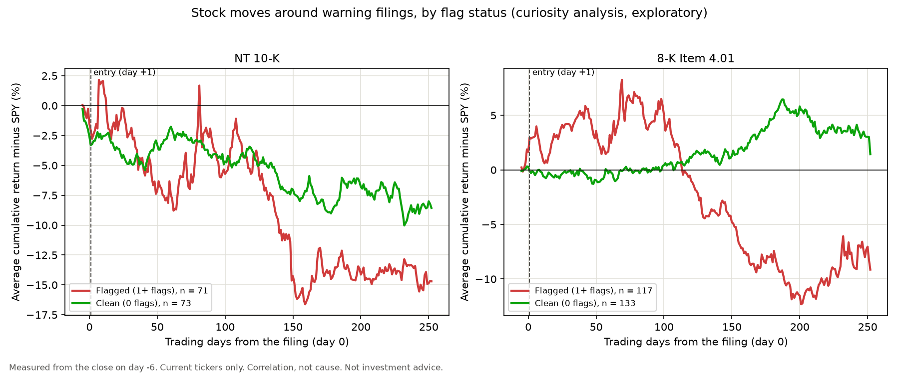

# Curiosity: do flagged companies' stocks fall more after a warning filing?

**Not part of the class project's test register** (`docs/backtest.md`).
When a company files a warning sign with the SEC (a late-filing notice
or an auditor change), do the stocks of companies our checks had
flagged fall more afterward than those of clean companies? Public data
only: the SEC submissions bulk file and the project's price table. This
is an analysis for a class project, not investment advice.

Definitions fixed before any result was computed; exploratory.

## Data

- **Filings:** `data/raw/submissions.zip` (SEC bulk file), every filing
  listed for the companies in the universe (the `companies` table, not
  excluded), including each company's older filings in the overflow
  files. The submissions data lists each 8-K's item numbers, so no 8-K
  document is downloaded.
- **Scores:** `scores`, with each score's 10-K filing date from
  `financials_annual`.
- **Prices:** the project's `prices` table (Yahoo adjusted closes) and
  SPY for the market; trading days are SPY's.
- **Step 1 check (counts only):** 10,032 NT 10-K and 8,103 original
  8-Ks with Item 4.01 filed 2014-2025; before the eligibility and repeat
  rules, 185 NT 10-K and 336 Item 4.01 events had a usable score with all
  three scores and a price on the entry day.

## Definitions

- **Events, analyzed separately:**
  - (A) NT 10-K filings (notices that the annual report will be late);
    the form "NT 10-K" only, not amendments (NT 10-K/A).
  - (B) original 8-Ks (form "8-K", not 8-K/A) whose listed items include
    4.01 (changes in the registrant's certifying accountant). Item 4.01
    covers resignations, dismissals and routine changes alike; they
    cannot be separated without reading each filing, which this
    analysis does not do.
  - Filing dates from 2014-01-01 to 2025-12-31.
- **Repeats.** For each company and event type, an event within 63
  market trading days after a kept event of the same type is dropped;
  only the first of a run is kept.
- **Flag status at the event.** The company's latest score whose 10-K
  was filed strictly before the event's filing date and no more than 15
  months before it, with an M-Score, a Z'' and an F-Score all present.
  Clean = 0 flags (`flags_raised`), Flagged = 1 or more. Events without
  such a score are excluded and counted.
- **Event days.** Day 0 is the filing date if it is a market trading
  day, otherwise the last trading day before it. Day +1, the entry day,
  is the first market trading day after the filing date (a filing can
  come after the market closes, so the filing day itself is not
  tradeable; a Friday filing enters on Monday). Days are counted in
  market trading days.
- **Entry.** The adjusted close on day +1.
- **Filing-day move (descriptive).** The close on day 0 against the close
  on day -1, minus SPY's move on the same day, reported only for events
  filed on a trading day. It shows how much of the reaction happens
  before anyone could act on the filing.
- **Eligibility.** A current ticker; a price on each of the 20 trading
  days before day 0 (days -20 to -1); and an adjusted close of at least
  $5 on day +1. The results are also reported without the $5 rule, as a
  descriptive check.
- **Outcome (registered window).** The market-adjusted return from day
  +1 to day +63: the stock's buy-and-hold return from the close on day +1
  to the close on day +63, minus SPY's return over the same days. An
  event whose stock has no price on day +63 (its prices stop, or the
  window runs past the end of the price data) is excluded from that
  window and counted by group.
- **Descriptive windows.** The same measure from day +1 to day +21, +126
  and +252, each with its own count of complete windows.
- **Registered questions, for each event type (4 in all):**
  - (a) Is the Flagged group's average market-adjusted return (days +1
    to +63) different from zero?
  - (b) Is the Flagged average different from the Clean average?
  - Both are estimated by ordinary least squares with standard errors
    clustered by company (statsmodels): (a) the outcome on a constant,
    over Flagged events; (b) the outcome on a constant and a Flagged
    indicator (0 or 1), over all events. Because 4 questions are tested,
    a question passes only if |t| >= 3.0 (two-sided, as "different"
    asks).
- **Descriptive:**
  - results by flag count (0, 1, 2 and 3);
  - the number of events per group per year;
  - a chart of the average cumulative market-adjusted return from day
    -5 to day +252 for Flagged and Clean, one panel per event type
    (`docs/curiosity/events_car.png`). The curve is measured from the
    close on day -6 (so the days before and the filing-day move show),
    with day +1 marked; on each day it averages the events with a price
    that day.

## Limitations, stated in advance

- **Survivorship.** Current tickers only. Late filers and companies
  whose auditor leaves are especially likely to delist later, so the
  worst outcomes are probably missing.
- **Few usable events.** Most events belong to companies without a
  usable score (step 1: about 2% of NT 10-K events and 4% of Item 4.01
  events remain before the eligibility and repeat rules), so the groups
  are small and the |t| >= 3.0 bar needs a large effect.
- **Events cluster in time** (for example, 2020).
- **Item 4.01 mixes** routine and alarming auditor changes.
- **Market reaction, not a trade.** This shows whether the market
  reacts after the event, not whether a short sale or put would profit
  after borrowing costs and option prices.
- **Correlation, not cause.** Not investment advice.

## Outputs

These results, whatever they show; `docs/curiosity/events_car.png`;
details in `data/logs/curiosity_events.csv`. Code:
`src/curiosity/events.py`. Tests: `tests/test_curiosity.py` (event date
to entry day, a Friday filing entering Monday; the 63-day repeat rule;
market adjustment on a hand-checked example).

## Results (run 2026-11-20)

Run with `python -m src.curiosity.events`. Everything above this section
was committed before any result was computed.

**Short answer: no registered question passed.** After a late-filing
notice, flagged companies' stocks lagged SPY over the next three months
(-7.7% on average, median -7.1%) while clean ones did not (+0.4%), but
with only 144 usable events the difference is not statistically clear
(t = -1.76 against the 3.0 bar). After an auditor change there was no
difference at all.

### How many events were usable

| Step | NT 10-K | 8-K Item 4.01 |
| --- | --- | --- |
| Filed 2014-2025 | 10,032 | 8,103 |
| After the 63-day repeat rule | 10,013 | 7,272 |
| With a usable score (all three scores, filed before, at most 15 months old) | 395 | 488 |
| ...no score before the event | 8,335 | 5,161 |
| ...a score missing the M, Z'' or F | 1,023 | 1,302 |
| ...score older than 15 months | 260 | 321 |
| With prices (current ticker, 20 days of history, entry price) | 185 | 304 |
| **Eligible: entry close at least $5** | **144** (73 Clean, 71 Flagged; 112 companies) | **250** (133 Clean, 117 Flagged; 207 companies) |

Every eligible event had a complete window for every horizon (one 8-K
event without the $5 rule lacked a complete 252-day window): no stock's
prices stopped within a year of the event, the same survivorship signal
as in the backtest.

Events per year (eligible, $5 rule):

| Year | 2014 | 2015 | 2016 | 2017 | 2018 | 2019 | 2020 | 2021 | 2022 | 2023 | 2024 | 2025 |
| --- | --- | --- | --- | --- | --- | --- | --- | --- | --- | --- | --- | --- |
| NT 10-K Clean | 1 | 8 | 5 | 6 | 5 | 11 | 5 | 5 | 6 | 9 | 6 | 6 |
| NT 10-K Flagged | 0 | 3 | 6 | 8 | 7 | 5 | 2 | 0 | 13 | 8 | 13 | 6 |
| Item 4.01 Clean | 17 | 9 | 7 | 9 | 10 | 10 | 13 | 2 | 13 | 11 | 18 | 14 |
| Item 4.01 Flagged | 2 | 7 | 10 | 4 | 7 | 8 | 3 | 13 | 16 | 17 | 18 | 12 |

### Registered questions (days +1 to +63, $5 rule)

Market-adjusted return = the stock's return minus SPY's, from the close
on the entry day (the first trading day after the filing) to day +63.
Standard errors clustered by company; pass mark |t| >= 3.0.

| Event | Question | Estimate | t | Passes? |
| --- | --- | --- | --- | --- |
| NT 10-K | (a) Flagged average different from zero | -7.7% | -2.01 | No |
| NT 10-K | (b) Flagged minus Clean (Clean average +0.4%) | -8.1 pts | -1.76 | No |
| 8-K Item 4.01 | (a) Flagged average different from zero | +2.0% | +0.48 | No |
| 8-K Item 4.01 | (b) Flagged minus Clean (Clean average -0.9%) | +2.8 pts | +0.63 | No |

### Descriptive results

Average market-adjusted return from the entry day, $5 rule (Flagged /
Clean; t for the difference):

| Event | Days +1 to +21 | +1 to +63 (registered) | +1 to +126 | +1 to +252 |
| --- | --- | --- | --- | --- |
| NT 10-K | -0.6% / -0.4% (t -0.04) | -7.7% / +0.4% (t -1.76) | -5.2% / -1.4% (t -0.48) | -13.2% / -5.3% (t -0.96) |
| 8-K Item 4.01 | +1.3% / -0.7% (t +0.82) | +2.0% / -0.9% (t +0.63) | -4.2% / +1.7% (t -1.02) | -9.7% / +1.4% (t -1.04) |

By flag count (days +1 to +63, $5 rule; average, events):

| Event | 0 flags | 1 flag | 2 flags | 3 flags |
| --- | --- | --- | --- | --- |
| NT 10-K | +0.4% (73) | -5.8% (40) | -12.1% (24) | -3.2% (7) |
| 8-K Item 4.01 | -0.9% (133) | +5.4% (77) | -6.5% (30) | +0.9% (10) |

The 3-flag rows rest on 7 and 10 events and cannot be read.

Filing-day move (the filing day's close against the day before, minus
SPY's move; filings made on a trading day): NT 10-K Flagged -1.2%, Clean
-0.6%; 8-K Item 4.01 Flagged -0.2%, Clean -0.1%. Little of the reaction
happens on the filing day itself, so entering the next day misses
little.

Checks made after the run (not registered):

- **The NT 10-K gap is broad, not a few stocks.** Median over days +1
  to +63: Flagged -7.1%, Clean +0.7%; 63% of Flagged and 47% of Clean
  events trailed SPY. For Item 4.01 the medians are close (Flagged -3.6%,
  Clean -4.2%).
- **Without the $5 rule** (185 NT 10-K and 304 Item 4.01 events), the
  averages are dominated by a few penny stocks: the largest 252-day
  returns are +1,509% (NT 10-K) and +5,842% (Item 4.01), on stocks that
  entered at $0.30 to $0.90. Those descriptive rows (Flagged averages of
  -0.7% and +3.8% over days +1 to +63; no t above 1.2) cannot be read as
  typical; this is why the $5 rule is part of the definitions.
- **Hand check.** Bio-Techne (TECH), NT 10-K filed Tuesday 2017-08-29:
  entry at the close on Wednesday 2017-08-30 (28.769), day +63 on
  2017-11-28 (31.825); SPY 213.28 to 229.03. By hand: +10.62% - 7.38% =
  +3.240%, as in the run.

### What this means

- A late-filing notice from a company the checks had flagged was
  followed by weaker returns over the next quarter and year in this
  sample, and the gap grew with the number of flags up to 2; but the
  evidence does not pass the bar set for four tests, and the groups are
  small.
- An auditor change told us nothing about flagged companies' returns
  over the next quarter.
- The chart's 8-K panel shows flagged stocks drifting lower in the
  second half of the year (to about -12% around day +200, measured from
  day -6), but no descriptive window with the $5 rule reaches |t| = 1.1,
  so it is not evidence.

### Limitations

Those stated in advance (survivorship: current tickers only, and late
filers and companies whose auditor leaves are especially likely to
delist, so the worst outcomes are probably missing; few usable events;
events clustered in time; Item 4.01 mixing routine and alarming changes;
a market reaction, not a tradeable profit after costs; correlation, not
cause), plus: the descriptive results without the $5 rule are driven by
a handful of penny stocks. Not investment advice.
