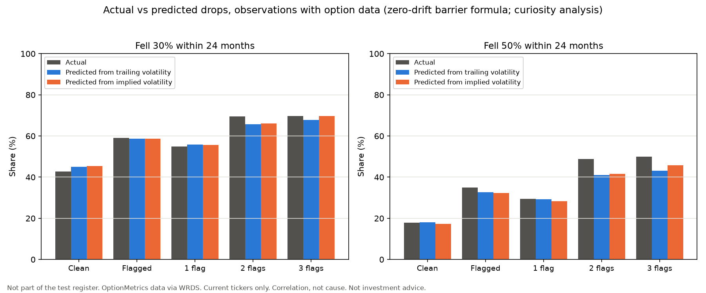
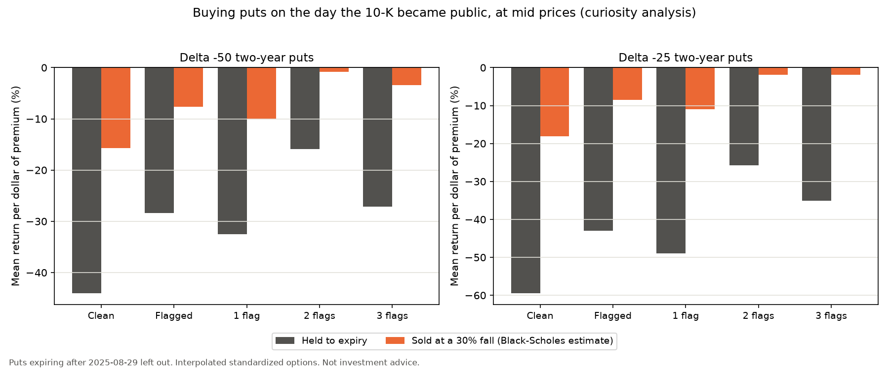

# Curiosity, part 2: did put prices on flagged stocks underestimate crashes?

**Not part of the class project's test register** (`docs/backtest.md`).
Part 1 (`vol_matched.md`) found that flagged stocks fell 30% or 50% more
often than their own trailing volatility predicts. The options market
prices crash risk through implied volatility, so the question here is
whether put prices already reflected that extra risk. This is an
analysis for a class project, not investment advice.

**Licensed data.** The OptionMetrics data from WRDS stays in
`data/raw/wrds/` (gitignored) and is never committed. At most 5 raw rows
are ever printed to the screen; only summary results are written to
docs, and the details file holds derived values per observation, not raw
WRDS rows.

Definitions fixed before any result was computed.

## Data

Each file is read by its exact name, never with a wildcard.

- **Volatility surface:** `data/raw/wrds/vsurf_puts_730d.csv.gz`,
  OptionMetrics standardized options (`optionm.vsurfd`), 730-day puts at
  delta -50 and -25, 2013-07-22 to 2024-06-28 (checked in step 1: only
  those days, deltas and put flags; 3,595,528 rows, 820 secids).
- **Name history:** `data/raw/wrds/secnmd_names.csv.gz`, OptionMetrics
  security names (`optionm.secnmd`) for the 820 secids in the surface
  file, used to confirm matches (4,146 rows; every secid present; no
  missing issuer names).
- **Security prices (approved and downloaded 2026-11-19, for analyses 3
  to 5):** `data/raw/wrds/secprd_prices.csv.gz`, OptionMetrics daily
  security prices (`optionm.secprd`: secid, date, close, volume and the
  cumulative adjustment factor `cfadj`) for the same 820 secids. Checked
  before use: 2,175,245 rows, every secid present, no missing values, no
  duplicate secid-date rows; it runs from 2013-07-01 to **2025-08-29**
  (the last date in the file, not the 2026-07-31 requested); 10 secids'
  prices end before that date; 2,134 rows have a negative close and 1 a
  zero close (see below).

## Definitions

- **Observations.** The 4,783 observations of part 1
  (`src/curiosity/vol_matched.py`): the same start dates, reference
  prices, trailing volatilities, drops and 24-month follow-up, reused
  from that module, not recomputed.
- **Usable surface row.** Implied volatility present, and strike and
  premium both above zero. A strike or premium of -99.99 (OptionMetrics'
  missing-value code) or 0 counts as missing. Applied to each delta
  separately.
- **Issue type.** The OptionMetrics `issue_type` code "F" means ADR/ADS
  (IvyDB US Reference Manual v5.0, Security file, Issue Type: 0 common
  stock, A market index, 7 mutual or investment trust fund, F ADR/ADS,
  % exchange-traded fund, S structured product, U unit, blank
  unspecified). Step 1 found 4 secids with "F". Matched observations
  that carry it are kept and counted, because our companies all file
  10-Ks and an ADR match is unusual.
- **Matching.** Both ticker fields are current tickers (the surface
  file's ticker is "the security's current ticker symbol" in the
  manual; ours are current SEC tickers). For each observation:
  1. Candidates: the secids whose surface-file ticker equals the
     company's ticker.
  2. For each candidate, the name-history row in effect on the
     observation's start date (the latest row with an effective date on
     or before the start).
  3. Name similarity between that name and the SEC company name: both
     names upper-cased, punctuation removed, and the words THE, INC,
     INCORPORATED, CORP, CORPORATION, CO, COMPANY, LTD, LIMITED, PLC,
     LLC, LP, HOLDINGS, HOLDING, GROUP, CLASS, CL, A, B and NEW dropped;
     similarity = Python's `difflib.SequenceMatcher` ratio of what is
     left. A match is accepted if the ratio is at least 0.85, or one
     cleaned name contains the other.
  4. Tickers with two secids: use the candidate whose name-history
     dates cover the start date and whose name passes the check. If
     both or neither pass, the observation is rejected and counted.
  5. Every company whose best candidate falls below the threshold is
     written, with both names and the ratio, to
     `data/raw/wrds/name_review.csv` (gitignored, because it contains
     licensed names), and at most 5 are printed. A pair is used only if
     approved by hand in that file before any result is computed;
     otherwise it is rejected and counted, never forced.
- **Fallback.** For each delta, the usable surface row on the start
  date; if there is none, the usable row on the closest earlier market
  trading day within 5 trading days (SPY's calendar); never a later
  day. Otherwise the observation has "no option data" for that delta,
  counted by group. The day used is the "option date".
- **Tradeability.** For Clean, Flagged, 2 flags and 3 flags: how many
  observations matched, how many have delta -50 data, and how many have
  delta -25 data.

## Analyses

1. **Implied-volatility benchmark.** Part 1's method 3 with implied
   volatility (delta -50, 730 days) in place of trailing volatility:
   P = 2 x N(ln(1 - d) / (sigma x sqrt(2))), actual against average
   predicted share reaching 30% and 50% drops within 24 months, by group
   (Clean, Flagged, 0 to 3 flags).
2. **Cox regression.** Part 1's method 2 with the log of implied
   volatility in place of the log of trailing volatility: Flagged and
   log implied volatility, Efron ties, standard errors clustered by
   company (statsmodels `PHReg`). The key result: whether Flagged's
   hazard ratio stays above 1 once the options market's own volatility is
   held equal. For comparison, part 1's trailing-volatility model is
   rerun on the same matched observations, so a change in the hazard
   ratio cannot come only from the smaller sample.
3. **Put held to expiry (exact, no model).** Buy the 730-day put at
   `impl_strike` for `impl_premium` on the option date; expiry is the
   last market trading day on or before the option date plus 730 days.
   Payoff = max(strike - stock price at expiry, 0). Return per dollar of
   premium = (payoff - premium) / premium. Reported for Clean, Flagged
   and 0 to 3 flags (mean, median and share with a positive return), at
   delta -50 and delta -25.
   - **Prices.** Strike and premium are in dollars as of the option
     date, but Yahoo adjusted closes are rescaled for every later split
     and dividend, so the two cannot be compared directly. The stock
     price at expiry is therefore taken from OptionMetrics `secprd`,
     converted to option-date share units with the adjustment factor:
     price at expiry x cfadj at expiry / cfadj on the option date. This
     corrects for splits, as option contracts do, and not for dividends,
     as option payoffs do not.

   **Price rules for analyses 3 to 5 (added 2026-11-19, after the
   security prices were checked and before any analysis 3 to 5 result
   was computed):**
   - **Negative and zero closes.** A negative close is the average of
     the closing bid and ask on a day without a trade (IvyDB US
     Reference Manual v5.0, Security_Price file, Close Price), so its
     absolute value is used as that day's price. A zero close counts as
     no price that day.
   - **Split adjustment.** `cfadj` is the cumulative split factor
     (dividends are in a separate factor not used here); the manual's
     conversion, close x cfadj that day / cfadj on another day, gives
     the price in that other day's share units, which is the formula
     above.
   - **Price on a day.** The close on that day; if the security has no
     price row that day, the latest earlier row within 5 trading days.
   - **Not yet expired in the data.** The price file ends on
     2025-08-29. A put whose expiry (the last market trading day on or
     before the option date plus 730 days) falls after that date is "not
     yet expired in the data": it is counted by group and left out of
     analyses 3 to 5. It is never valued at the last available price.
   - **Prices that stop for the security.** If a security's own prices
     stop before its expiry while the file continues past that expiry
     (for example a delisting), the put is valued at its intrinsic value
     on the security's last price day and counted separately. This was
     the original rule for prices that stop; it now applies only to a
     security's own prices stopping, not to the end of the file.
4. **Put with an exit rule (approximate).** Sell when the stock first
   closes 30% or more below the reference price (the option-date close
   from `secprd`, in the same split-adjusted units), or at expiry. At an
   early exit, value the put two ways:
   - intrinsic value, max(strike - price, 0): a lower bound, because a
     put with time left is worth at least its exercise value;
   - Black-Scholes, using the option date's implied volatility, the
     remaining time to expiry, and an interest rate and dividend yield
     of zero: an estimate, because the real implied volatility at the
     exit (usually higher after a crash), interest rates and dividends
     all differ.
5. **Costs.** Analyses 3 and 4 repeated with the purchase price raised
   5% and 10% above `impl_premium`, to stand in for paying the ask
   rather than the mid price.

### Extension: 50% and 70% exit thresholds

Added before any 50% or 70% result was computed; the 30% result was
already known, so these are exploratory.

- **Thresholds.** Analyses 4 and 5 are repeated with two more exit
  rules, decided together: sell when the stock first closes 50% or more
  below the reference price (at or below 50% of the option-date close),
  or 70% or more below it (at or below 30%); otherwise hold to expiry
  (730 days). Each threshold is a separate rule applied to the whole
  life of the put; nothing is carried over from the 30% rule.
- **Everything else unchanged.** The same deltas (-50 and -25), the
  same two early-exit valuations (intrinsic value as a floor and the
  Black-Scholes estimate, with the option date's implied volatility,
  the remaining time and zero rate and dividend), the same mid, +5% and
  +10% purchase prices, the same price rules, and the same valued puts
  (those whose expiry is on or before 2025-08-29).
- **Reported next to the existing 30% rows:** for each threshold, delta,
  valuation and purchase price, the mean and median return per dollar
  of premium and the share with a positive return, by group (Clean,
  Flagged) and by flag count (0 to 3); and the number of puts that hit
  the threshold before expiry.
- **Analysis 1 extended to 70% drops.** Actual against
  implied-volatility-predicted share reaching a 70% drop within 24
  months, by group, on the same 4,317 observations with delta -50 data.
  The drop is defined exactly as in tests 11 and 12 (the first close at
  or below 30% of the start price, from adjusted closes), and the
  prediction uses the same zero-drift formula with d = 0.7.
- **Small rows.** Every reported row resting on fewer than 50 puts (or,
  for analysis 1, fewer than 50 observations) is marked "too small to
  read".
- **Reported whatever the results show.**

## Limitations, stated in advance

- Standardized options are interpolated from listed options and may not
  correspond to any contract that traded; `impl_premium` is a mid price.
- Survivorship: current tickers only.
- Companies without listed options are excluded, and they are likely
  the riskiest.
- Years already studied in tests 1 to 12 and part 1.
- Interest rates and dividends are simplified (zero in the Black-Scholes
  estimate; dividends ignored in the hold-to-expiry payoff, as in a real
  put).
- Correlation, not cause. Not investment advice.

## Outputs

These results, whatever they show; charts in `docs/curiosity/`; details
in `data/logs/curiosity_implied_vol.csv` (derived values per
observation, no raw WRDS rows). Code: `src/curiosity/implied_vol.py`.
Tests: `tests/test_curiosity.py` (put payoff at expiry on a hand-checked
example, the exit rule on a fake price path, and the fallback rule: a
missing start date filled from 2 days earlier, never from a later day).

## Results (run 2026-11-19)

Run with `python -m src.curiosity.implied_vol --results` (matching
alone: without `--results`). Everything above this section was committed
before any result was computed. Only summary results are shown here; no
raw OptionMetrics rows.

**Short answer: the options market already priced most of it.** Once
each stock's implied volatility is held equal, the flags no longer add a
statistically clear signal about 30% or 50% drops. With trailing
volatility on the same observations they still do (part 1's result).
Buying two-year puts on flagged stocks lost money on average, though
less than on clean stocks.

### Matching and the name review

- 4,513 of the 4,783 observations were matched to an OptionMetrics
  security. Not matched: 261 whose ticker is not in the WRDS data, 5
  ambiguous (two secids of one ticker both passed the name check), 3
  whose name did not match, and 1 with no name history on the start
  date.
- **The hand review was delegated to Claude by the user** (2026-11-19).
  Of the 131 pairs below the name threshold, 128 were approved and 3
  rejected, using two pieces of evidence recorded in the gitignored
  review file: one of the company's former SEC names matches the WRDS
  name (77 pairs), or the security's own name history later carries
  today's SEC name (125 pairs; OptionMetrics security IDs are never
  recycled, so this is a renamed security, not a reused ticker). Every
  approval rested on a similarity of at least 0.85 or a shared name of
  at least 6 letters; a random sample of 5 was checked by eye. The 3
  rejected pairs had neither kind of evidence and are different
  companies using the same ticker. Each decision and its basis is noted
  in the review file.
- 23 matched observations are on a security that OptionMetrics codes as
  an ADR/ADS (issue type F). They were kept, as the definitions say.

### Tradeability

| Group | Observations | Matched | With delta -50 data | With delta -25 data |
| --- | --- | --- | --- | --- |
| Clean | 3,094 | 2,916 | 2,839 | 2,839 |
| Flagged | 1,689 | 1,597 | 1,478 | 1,480 |
| 2 flags | 420 | 394 | 350 | 351 |
| 3 flags | 80 | 77 | 66 | 66 |

About 92% of Clean and 88% of Flagged observations have delta -50 option
data (83% for 3 flags). The analyses below use the 4,317 observations
with delta -50 data (790 companies). Those without it are excluded and,
as the limitations note, may be among the riskiest.

### Analysis 1: implied-volatility benchmark

Actual share that dropped within 24 months against the average chance
predicted by the zero-drift formula, from implied volatility and, on the
same observations, from trailing volatility:

| Group | Observations | 30% drop: actual | Predicted (implied) | Actual / predicted (implied) | Actual / predicted (trailing) | 50% drop: actual | Predicted (implied) | Actual / predicted (implied) | Actual / predicted (trailing) |
| --- | --- | --- | --- | --- | --- | --- | --- | --- | --- |
| Clean | 2,839 | 42.7% | 45.3% | 0.94 | 0.95 | 17.9% | 17.3% | 1.03 | 0.99 |
| Flagged | 1,478 | 59.1% | 58.7% | 1.01 | 1.01 | 34.9% | 32.2% | 1.08 | 1.07 |
| 1 flag | 1,062 | 55.0% | 55.6% | 0.99 | 0.99 | 29.4% | 28.3% | 1.04 | 1.01 |
| 2 flags | 350 | 69.4% | 66.2% | 1.05 | 1.06 | 48.9% | 41.6% | 1.17 | 1.19 |
| 3 flags | 66 | 69.7% | 69.6% | 1.00 | 1.03 | 50.0% | 45.8% | 1.09 | 1.16 |

- Implied volatility predicts the groups' drop rates about as well as
  trailing volatility, and both come close: Flagged stocks dropped 30%
  almost exactly as often as predicted (1.01).
- The clearest excess is for 50% drops with 2 flags: 48.9% actual
  against 41.6% predicted from implied volatility (1.17), on 350
  observations. The 3-flag group (66 observations) is too small to read
  much into.

### Analysis 2: Cox regression, implied vs trailing volatility

Same 4,317 observations, Flagged and the log of volatility as inputs,
Efron ties, standard errors clustered by company (790):

| Drop | Volatility held equal | Hazard ratio for Flagged | 95% interval | p-value |
| --- | --- | --- | --- | --- |
| 30% | Implied (options market) | 1.08 | 0.97 to 1.20 | 0.15 |
| 30% | Trailing (price history) | 1.18 | 1.07 to 1.31 | 0.0013 |
| 50% | Implied (options market) | 1.09 | 0.94 to 1.27 | 0.26 |
| 50% | Trailing (price history) | 1.22 | 1.06 to 1.41 | 0.0057 |

- **The key result:** with the options market's own volatility held
  equal, Flagged's hazard ratio falls to about 1.08 to 1.09 and its
  interval includes 1, so the flags no longer show a clear extra risk.
  With trailing volatility on the same observations, the extra risk
  remains (1.18 to 1.22), so the change comes from switching to implied
  volatility, not from the smaller sample.
- In plain English: put prices on flagged stocks were already high
  enough to reflect most of their extra crash risk. Implied volatility
  also predicts drops more strongly than trailing volatility does
  (hazard ratios per unit of log volatility of 4.0 and 7.6, against 3.1
  and 5.8).
- Absence of a clear signal is not proof of none: the point estimates
  are still above 1, and the 50% drop with 2 flags stands out in
  analysis 1.

### Analyses 3 to 5: put payoffs (run 2026-11-19, after the price rules were committed)

Run with `python -m src.curiosity.implied_vol --results --puts`, using
the security prices in `data/raw/wrds/secprd_prices.csv.gz` and the price
rules added to the definitions before this run. A put is valued only if
its two-year life ended by 2025-08-29, the last date in the price file.

**Which puts were valued** (delta -50; delta -25 differs by at most 2):

| Group | Valued | Of which the security's prices stopped before expiry | Not yet expired in the data (left out) |
| --- | --- | --- | --- |
| Clean | 2,559 | 4 | 280 |
| Flagged | 1,306 | 4 | 172 |
| 1 flag | 947 | 2 | 115 |
| 2 flags | 302 | 1 | 48 |
| 3 flags | 57 | 1 | 9 |

No put lacked a price on its option date. The put's strike and premium
are on the scale expected for two-year puts (median strike 1.17 times
the stock price at delta -50 and 0.83 times at delta -25; median premium
30% and 12% of the stock price), and one put was recomputed by hand
from the files (held to expiry, intrinsic exit and Black-Scholes exit
all matched to four decimals).

**Mean return per dollar of premium, bought at the mid price** (5% and
10% columns: analysis 5, the price paid raised to stand in for the
bid-ask spread):

| Put and valuation | Group | Mid | +5% | +10% | Median (mid) | Share positive (mid) |
| --- | --- | --- | --- | --- | --- | --- |
| Delta -50, held to expiry (exact) | Clean | -44.1% | -46.7% | -49.1% | -100% | 25.0% |
| | Flagged | -28.4% | -31.8% | -34.9% | -46.9% | 37.1% |
| | 1 flag | -32.5% | -35.7% | -38.6% | -63.6% | 34.6% |
| | 2 flags | -15.9% | -19.9% | -23.5% | -12.5% | 44.7% |
| | 3 flags | -27.1% | -30.6% | -33.8% | -40.9% | 38.6% |
| Delta -50, sold at a 30% fall, Black-Scholes estimate | Clean | -15.7% | -19.7% | -23.4% | -40.7% | 45.4% |
| | Flagged | -7.6% | -12.0% | -16.0% | +16.5% | 60.9% |
| | 2 flags | -0.9% | -5.6% | -9.9% | +17.1% | 69.9% |
| Delta -50, sold at a 30% fall, intrinsic (lower bound) | Clean | -18.1% | -22.0% | -25.6% | -40.7% | 45.4% |
| | Flagged | -11.8% | -16.0% | -19.9% | +9.4% | 60.7% |
| Delta -25, held to expiry (exact) | Clean | -59.5% | -61.4% | -63.2% | -100% | 14.7% |
| | Flagged | -43.0% | -45.7% | -48.2% | -100% | 24.5% |
| | 2 flags | -25.7% | -29.3% | -32.5% | -100% | 36.3% |
| Delta -25, sold at a 30% fall, Black-Scholes estimate | Clean | -18.1% | -22.0% | -25.6% | -100% | 41.7% |
| | Flagged | -8.5% | -12.9% | -16.8% | +13.4% | 55.7% |
| | 2 flags | -1.9% | -6.6% | -10.8% | +19.5% | 65.3% |
| Delta -25, sold at a 30% fall, intrinsic (lower bound) | Clean | -42.2% | -45.0% | -47.5% | -100% | 25.9% |
| | Flagged | -43.1% | -45.8% | -48.3% | -37.7% | 15.8% |

Every group and tier is in `data/logs/curiosity_implied_vol.csv`
(derived values only) and the run output.

What this shows:

- **No group made money on average.** Every mean return is negative,
  for both deltas, both ways of selling, and at mid prices before any
  spread. Paying 5% above the mid price lowers each mean return by 1.9 to
  4.7 points, and paying 10% above it by 3.7 to 9.0 points.
- **Puts on flagged stocks lost less than puts on clean stocks** (for
  example -28% against -44% held to expiry at delta -50), and 2-flag
  stocks came closest to breaking even (-1% sold at a 30% fall, by the
  Black-Scholes estimate). This fits analysis 1: their actual 50% drops
  ran a little ahead of what implied volatility predicted.
- **Holding to expiry was the worst choice everywhere.** Stocks that
  fell often recovered within two years, so the typical put held to
  expiry lost most or all of its premium (median -100% for clean
  stocks).
- **The far out-of-the-money puts show the pricing most clearly.** At
  delta -25 and valued at intrinsic value, flagged puts did no better
  than clean ones (15.8% profitable against 25.9%). Their implied
  volatility was higher (median 0.61 against 0.42 among early exits), so
  their premium was larger (0.21 against 0.12 times the stock price),
  and a 30% fall left an intrinsic value (about 0.17 times the price)
  below what had been paid. The market had already charged for the
  extra risk.
- **The two valuations of an early exit bracket the true value.**
  Intrinsic value is a floor; the Black-Scholes estimate uses the
  option-date implied volatility, while implied volatility usually
  rises after a crash, so the real exit price was probably at or above
  the estimate. Neither is a traded price.

### Extension: exits at a 50% and a 70% fall (exploratory, run 2026-11-19)

Run with the same command, after the extension's definitions were
committed. Exploratory: the 30% result was known when the 50% and 70%
thresholds were chosen. The 30% rows below are the earlier results,
reproduced exactly by this run. Each threshold is its own rule; a put
that never reaches it is held to expiry. Per the committed rule, a row
on fewer than 50 puts is "too small to read": no row is, because the
smallest group (3 flags) has 57 valued puts. But a row's exit effect
rests only on the puts that hit the threshold, and for 3 flags that is
40, 28 and 19 puts at the 30%, 50% and 70% falls (marked "fewer than 50
hits" below), so read those rows with care.

**Delta -50, bought at the mid price:** mean return per dollar of premium (median; share positive)

| Exit at | Valuation | Clean | Flagged | 0 flags | 1 flag | 2 flags | 3 flags |
| --- | --- | --- | --- | --- | --- | --- | --- |
| 30% fall | Black-Scholes estimate | -15.7% (-41%; 45%) | -7.6% (+16%; 61%) | -15.7% (-41%; 45%) | -10.0% (+16%; 57%) | -0.9% (+17%; 70%) | -3.4% (+17%; 70%) |
| 30% fall | intrinsic (floor) | -18.1% (-41%; 45%) | -11.8% (+9%; 61%) | -18.1% (-41%; 45%) | -13.9% (+9%; 57%) | -6.1% (+10%; 70%) | -9.0% (+7%; 70%) |
| 50% fall | Black-Scholes estimate | -32.3% (-100%; 30%) | -18.1% (-23%; 45%) | -32.3% (-100%; 30%) | -22.2% (-44%; 41%) | -5.3% (+11%; 55%) | -17.6% (+8%; 53%) |
| 50% fall | intrinsic (floor) | -32.5% (-100%; 30%) | -18.7% (-23%; 45%) | -32.5% (-100%; 30%) | -22.6% (-44%; 41%) | -6.2% (+10%; 55%) | -18.7% (+7%; 53%) |
| 70% fall | Black-Scholes estimate | -41.4% (-100%; 26%) | -25.1% (-43%; 39%) | -41.4% (-100%; 26%) | -29.6% (-63%; 35%) | -11.1% (-9%; 47%) | -23.1% (-33%; 42%) |
| 70% fall | intrinsic (floor) | -41.4% (-100%; 26%) | -25.1% (-43%; 39%) | -41.4% (-100%; 26%) | -29.6% (-63%; 35%) | -11.2% (-9%; 47%) | -23.2% (-33%; 42%) |

**Delta -25, bought at the mid price:** mean return per dollar of premium (median; share positive)

| Exit at | Valuation | Clean | Flagged | 0 flags | 1 flag | 2 flags | 3 flags |
| --- | --- | --- | --- | --- | --- | --- | --- |
| 30% fall | Black-Scholes estimate | -18.1% (-100%; 42%) | -8.5% (+13%; 56%) | -18.1% (-100%; 42%) | -11.0% (+7%; 52%) | -1.9% (+20%; 65%) | -1.9% (+24%; 67%) |
| 30% fall | intrinsic (floor) | -42.2% (-100%; 26%) | -43.1% (-38%; 16%) | -42.2% (-100%; 26%) | -43.9% (-41%; 18%) | -40.9% (-33%; 10%) | -41.5% (-33%; 11%) |
| 50% fall | Black-Scholes estimate | -39.7% (-100%; 22%) | -25.2% (-100%; 37%) | -39.7% (-100%; 22%) | -30.5% (-100%; 32%) | -8.8% (+3%; 50%) | -23.2% (+4%; 51%) |
| 50% fall | intrinsic (floor) | -42.0% (-100%; 22%) | -31.3% (-100%; 36%) | -42.0% (-100%; 22%) | -35.4% (-100%; 31%) | -18.3% (-4%; 47%) | -33.5% (-2%; 47%) |
| 70% fall | Black-Scholes estimate | -54.3% (-100%; 16%) | -36.6% (-100%; 27%) | -54.3% (-100%; 16%) | -43.0% (-100%; 22%) | -17.6% (-100%; 39%) | -30.8% (-100%; 39%) |
| 70% fall | intrinsic (floor) | -54.4% (-100%; 16%) | -37.1% (-100%; 27%) | -54.4% (-100%; 16%) | -43.3% (-100%; 22%) | -18.7% (-100%; 39%) | -32.0% (-100%; 39%) |

**Puts that hit each threshold before expiry** (of the valued puts in the group):

| Delta | Exit at | Clean | Flagged | 0 flags | 1 flag | 2 flags | 3 flags |
| --- | --- | --- | --- | --- | --- | --- | --- |
| -50 | 30% fall | 1,091 of 2,559 | 776 of 1,306 | 1,091 of 2,559 | 527 of 947 | 209 of 302 | 40 of 57 (fewer than 50 hits) |
| -50 | 50% fall | 463 of 2,559 | 454 of 1,306 | 463 of 2,559 | 281 of 947 | 145 of 302 | 28 of 57 (fewer than 50 hits) |
| -50 | 70% fall | 131 of 2,559 | 232 of 1,306 | 131 of 2,559 | 122 of 947 | 91 of 302 | 19 of 57 (fewer than 50 hits) |
| -25 | 30% fall | 1,091 of 2,559 | 778 of 1,308 | 1,091 of 2,559 | 528 of 948 | 210 of 303 | 40 of 57 (fewer than 50 hits) |
| -25 | 50% fall | 463 of 2,559 | 455 of 1,308 | 463 of 2,559 | 281 of 948 | 146 of 303 | 28 of 57 (fewer than 50 hits) |
| -25 | 70% fall | 131 of 2,559 | 232 of 1,308 | 131 of 2,559 | 122 of 948 | 91 of 303 | 19 of 57 (fewer than 50 hits) |

**Analysis 5 for the new thresholds:** mean return per dollar of premium, Black-Scholes estimate, at mid / +5% / +10%:

| Delta | Exit at | Clean | Flagged | 0 flags | 1 flag | 2 flags | 3 flags |
| --- | --- | --- | --- | --- | --- | --- | --- |
| -50 | 30% fall | -15.7% / -19.7% / -23.4% | -7.6% / -12.0% / -16.0% | -15.7% / -19.7% / -23.4% | -10.0% / -14.3% / -18.2% | -0.9% / -5.6% / -9.9% | -3.4% / -8.0% / -12.2% |
| -50 | 50% fall | -32.3% / -35.5% / -38.5% | -18.1% / -22.0% / -25.6% | -32.3% / -35.5% / -38.5% | -22.2% / -25.9% / -29.3% | -5.3% / -9.8% / -13.9% | -17.6% / -21.6% / -25.1% |
| -50 | 70% fall | -41.4% / -44.2% / -46.7% | -25.1% / -28.6% / -31.9% | -41.4% / -44.2% / -46.7% | -29.6% / -33.0% / -36.0% | -11.1% / -15.4% / -19.2% | -23.1% / -26.7% / -30.1% |
| -25 | 30% fall | -18.1% / -22.0% / -25.6% | -8.5% / -12.9% / -16.8% | -18.1% / -22.0% / -25.6% | -11.0% / -15.2% / -19.1% | -1.9% / -6.6% / -10.8% | -1.9% / -6.6% / -10.8% |
| -25 | 50% fall | -39.7% / -42.6% / -45.2% | -25.2% / -28.7% / -32.0% | -39.7% / -42.6% / -45.2% | -30.5% / -33.8% / -36.8% | -8.8% / -13.2% / -17.1% | -23.2% / -26.9% / -30.2% |
| -25 | 70% fall | -54.3% / -56.5% / -58.5% | -36.6% / -39.6% / -42.4% | -54.3% / -56.5% / -58.5% | -43.0% / -45.8% / -48.2% | -17.6% / -21.5% / -25.1% | -30.8% / -34.1% / -37.1% |

The intrinsic-value rows at +5% and +10% are in
`data/logs/curiosity_put_summary.csv` (derived values only).

**Analysis 1 extended to 70% drops** (same 4,317 observations; drop
detected as in tests 11 and 12; predicted by the zero-drift formula from
implied volatility):

| Group | Observations | Actual | Predicted from implied volatility | Actual / predicted |
| --- | --- | --- | --- | --- |
| Clean | 2,839 | 5.0% | 3.7% | 1.34 |
| Flagged | 1,478 | 17.8% | 12.4% | 1.44 |
| 1 flag | 1,062 | 12.8% | 9.6% | 1.34 |
| 2 flags | 350 | 30.0% | 19.1% | 1.57 |
| 3 flags | 66 | 33.3% | 22.0% | 1.52 |

No row is under 50 observations. Cross-check between the two price
sources: 5.1% of Clean puts hit the 70% exit in the OptionMetrics prices
(131 of 2,559), against 5.0% of Clean observations falling 70% in the
adjusted closes.

What the extension shows:

- **Still no group made money on average.** Every mean return is
  negative at every threshold, for both deltas, both valuations and all
  three prices.
- **Waiting for a deeper fall made things worse.** With the
  Black-Scholes estimate, every group lost more at a 50% exit than at
  30%, and more at 70% than at 50%, for both deltas and all prices (for
  example, delta -50 Clean -15.7%, -32.3%, -41.4%; Flagged -7.6%,
  -18.1%, -25.1%). Fewer stocks fall that far, and the rest are held to
  expiry, which was the worst outcome. The only exceptions are the delta
  -25 intrinsic-value rows, where the 30% exit is valued at a very low
  floor (a far out-of-the-money put has little intrinsic value right
  after a 30% fall).
- **At a 70% fall the two valuations agree** (within 1.3 points): by
  then the put is deep in the money and nearly all of its value is
  intrinsic.
- **Puts on flagged stocks again lost less than on clean stocks,** in
  every row except the three delta -25, 30%, intrinsic rows already
  explained above, and 2-flag stocks again came closest to breaking even
  (-5.3% at a 50% exit, delta -50, Black-Scholes estimate).
- **Deep drops were more common than the simple model predicts, for
  every group.** Actual 70% drops ran 1.34 times the implied-volatility
  prediction for Clean stocks and 1.44 times for Flagged ones (1.57 for
  2 flags). Most of this gap is the formula's own limit: it assumes
  normally distributed returns, while real crashes are more frequent (fat
  tails). The excess is only modestly larger for flagged stocks, which
  fits analysis 2: the options market priced most, not all, of their
  extra crash risk.

### What this means

- Part 1 found that the flags signal crash risk beyond a stock's past
  volatility. Part 2 suggests the options market already knew: once
  implied volatility is held equal, little extra risk remains, and
  buying puts on flagged stocks lost money on average, only less than on
  clean stocks. This is consistent with the flags summarizing public
  information that option traders also use.
- For the project, this supports presenting the flags as a transparent,
  explainable risk screen, not as a source of trading profits.

### Limitations

Those stated in advance (interpolated standardized options and mid
prices; current tickers only; companies without listed options
excluded; years already studied; simplified rates and dividends;
correlation, not cause), plus: the name review was made by Claude on the
user's instruction rather than by a person, using the recorded evidence
above. Not investment advice.

