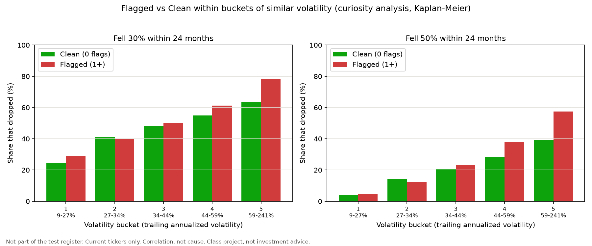

# Curiosity: do the flags predict large drops beyond volatility?

**Not part of the class project's test register** (`docs/backtest.md`).
A side question: tests 10 to 12 found that flagged stocks fall 30% or
50% more often, but flagged companies are also more volatile, and
volatile stocks touch any lower price more often. Do the flags add
information beyond a stock's own volatility? This is an analysis for a
class project, not investment advice.

Definitions fixed before any result was computed.

## Definitions

- **Observations.** Exactly test 11's eligible observations: scored
  company-years with an M-Score, a Z'' and an F-Score, original 10-K
  filed through 2024-06-30, the same eligibility checks, the same start
  day (first market trading day on or after the filing date) and
  reference price (the stock's adjusted close that day), and the same
  24-month follow-up and censoring. The code reuses test 11's functions
  (`src/scores/time_to_drop.py`) rather than rewriting them.
- **Trailing volatility.** The annualized standard deviation of daily
  log returns of adjusted close over the 252 market trading days ending
  the day before the start: daily standard deviation (sample, n - 1) x
  the square root of 252. A daily log return is ln(close that day /
  close the previous market trading day) and counts only when the stock
  has a price on both days. At least 200 valid daily returns are
  required; otherwise the observation is excluded and counted.
- **Volatility buckets.** Quintiles (five equal-sized groups) of trailing
  volatility across all observations pooled. The cutoffs and the number
  of Clean and Flagged observations in each bucket are reported. A
  bucket with fewer than 30 Clean or fewer than 30 Flagged observations
  is marked "too few to compare" and left out of the volatility-adjusted
  gap (method 1).
- **Drops.** 30% and 50%, defined exactly as in tests 11 and 12: the
  first close after the start at or below 70% or 50% of the reference
  price within the 24-month follow-up.
- **Groups.** Clean (`flags_raised` = 0) and Flagged (1 or more); also
  0, 1, 2 and 3 flags as a descriptive breakdown.

## Three ways to answer the question

1. **Within-bucket comparison.** For each bucket and drop size: the
   24-month share that dropped (Kaplan-Meier, as in tests 11 and 12) for
   Clean and Flagged, the gap (Flagged minus Clean, in points) and the
   ratio (Flagged / Clean). Then a volatility-adjusted gap: the average
   of the within-bucket gaps, weighted by each bucket's total
   observations, over the buckets that are not "too few to compare".
2. **Regression.** A Cox proportional hazards model of time to each
   drop, with Flagged (0 or 1) and the natural log of trailing
   volatility as inputs, ties handled by the Efron method, and standard
   errors clustered by company (one company appears in several years).
   Reported: the hazard ratio for Flagged with its 95% confidence
   interval and p-value. In plain English: a hazard ratio of 1.5 means
   flagged stocks reached the drop at 1.5 times the rate of clean stocks
   with the same volatility. Library: statsmodels 0.15.0 (`PHReg`, with
   company as the clustering groups), added to `requirements.txt` with
   `wrapt` pinned to the stable 2.5.2 (otherwise pip picks a
   pre-release). `lifelines` is not used because it cannot be installed
   with the project's pandas 3 (test 11, change 11a).
3. **Volatility-only benchmark.** For each observation, the chance of
   touching the drop within 24 months that a simple model predicts from
   volatility alone: P = 2 x N(ln(1 - d) / (sigma x sqrt(2))), where d
   is the drop size, sigma the trailing volatility, 2 the years and N
   the standard normal cumulative distribution. For each group (Clean,
   Flagged, and 0 to 3 flags), the actual share that dropped (drops /
   observations; censoring only at the end of follow-up, as found in
   test 11) is compared with the average predicted P. If Flagged stocks
   drop more often than their own volatility predicts and Clean stocks
   do not, the flags carry information beyond volatility. This model
   assumes no drift (no expected rise or fall in the log price) and
   normally distributed returns, so it ignores trends and the fat tails
   of real returns: it is a rough yardstick, not a price.

## Robustness check

Reported alongside method 1, not in place of it: method 1 repeated with
daily log returns clipped at the 1st and 99th percentiles of all daily
returns in all observations' volatility windows (pooled) before
volatility is computed, because one-day price glitches can inflate
volatility. The buckets are re-formed from the clipped volatilities.

## Limitations, stated in advance

- **Survivorship.** Current tickers only, so companies that crashed and
  delisted are mostly missing.
- **Years already studied** in tests 1 to 12; this question was chosen
  after seeing their results.
- **Historical volatility is not implied volatility.** Options are
  priced on implied volatility, which usually includes an extra charge
  for crash protection, so even a positive result does not show that
  buying puts on flagged stocks would profit.
- **Correlation, not cause.** Not investment advice.

## Outputs

These results, whatever they show; a chart of the 24-month drop share by
volatility bucket, Clean and Flagged side by side, for each drop size
(`docs/curiosity/vol_buckets.png`); details in
`data/logs/curiosity_vol_matched.csv`. Code: `src/curiosity/vol_matched.py`.
Tests: `tests/test_curiosity.py`.

## Results (run 2026-11-19)

Run with `python -m src.curiosity.vol_matched`. Everything above this
section was committed before any result was computed.

**Short answer: mostly volatility, partly not.** About 70% of the raw
Flagged-Clean gap disappears once stocks of similar volatility are
compared, but a smaller gap remains under all three methods, and it is
concentrated among the most volatile stocks.

**Observations.** 4,784 eligible observations from test 11; 1 (Flagged)
had fewer than 200 valid daily returns and was excluded, leaving 4,783
(3,094 Clean, 1,689 Flagged, from 872 companies). Flagged stocks were
more volatile: median trailing volatility 51.7% a year against 34.0% for
Clean.

**Volatility buckets** (cutoffs, annualized): 9.0%, 26.8%, 34.4%,
44.0%, 59.0%, 241.3%. No bucket had fewer than 30 Clean or 30 Flagged
observations, so none is "too few to compare".

### Method 1: within-bucket comparison

Share that dropped within 24 months (Kaplan-Meier):

| Bucket (volatility) | Clean / Flagged observations | 30% drop: Clean | Flagged | Gap | 50% drop: Clean | Flagged | Gap |
| --- | --- | --- | --- | --- | --- | --- | --- |
| 1 (9-27%) | 812 / 145 | 24.5% | 29.0% | +4.4 pts | 4.2% | 4.8% | +0.6 pts |
| 2 (27-34%) | 765 / 191 | 41.3% | 39.8% | -1.5 pts | 14.3% | 12.6% | -1.7 pts |
| 3 (34-44%) | 669 / 288 | 48.0% | 50.1% | +2.1 pts | 20.8% | 23.3% | +2.5 pts |
| 4 (44-59%) | 552 / 404 | 55.0% | 61.1% | +6.1 pts | 28.4% | 37.9% | +9.5 pts |
| 5 (59-241%) | 296 / 661 | 63.9% | 78.2% | +14.4 pts | 39.3% | 57.5% | +18.2 pts |

| Drop | Raw gap (no volatility matching) | Volatility-adjusted gap | Robustness: clipped returns |
| --- | --- | --- | --- |
| 30% | +17.8 pts | +5.1 pts | +4.4 pts |
| 50% | +19.4 pts | +5.8 pts | +5.4 pts |

- Matching on volatility shrinks the gap by about 70% (17.8 to 5.1
  points for 30% drops; 19.4 to 5.8 for 50%).
- What remains comes mostly from the two most volatile buckets. In the
  three calmest buckets the gap is small and changes sign.
- Caveat for bucket 5: it spans 59% to 241% volatility, and within it
  Flagged stocks were more volatile than Clean ones (median 74.7% against
  68.7%; in buckets 1 to 4 the medians differ by at most 1.2 points). So
  part of bucket 5's gap is still volatility; method 2 adjusts for
  volatility continuously and is the better guide there.
- Robustness: clipping daily returns at the pooled 1st and 99th
  percentiles (-8.5% and +8.7% a day) narrows the top bucket (its upper
  cutoff falls from 241% to 98%) and lowers the adjusted gaps a little,
  to +4.4 and +5.4 points. The conclusion is the same.

### Method 2: Cox regression (Flagged and log volatility together)

| Drop | Hazard ratio for Flagged | 95% interval | p-value (clustered by company) | Drops / observations |
| --- | --- | --- | --- | --- |
| 30% | 1.25 | 1.13 to 1.37 | 1.2 x 10^-5 | 2,356 / 4,783 |
| 50% | 1.36 | 1.19 to 1.56 | 9.9 x 10^-6 | 1,187 / 4,783 |

In plain English: among stocks with the same trailing volatility,
flagged stocks reached a 30% drop at 1.25 times the rate of clean
stocks, and a 50% drop at 1.36 times the rate. Volatility itself
matters much more: each doubling of volatility multiplies the rate of a
50% drop by about 3.2 (hazard ratio 5.35 per unit of log volatility).
The standard errors are clustered by company, which addresses the
repeated-company problem that made tests 11 and 12's p-values too
optimistic. The model assumes the Flagged effect is proportional over
the 24 months; that assumption was not tested here.

### Method 3: volatility-only benchmark

Actual share that dropped within 24 months against the average chance
predicted from each stock's own volatility (zero-drift formula):

| Group | Observations | Median volatility | 30% drop: actual | Predicted | Actual / predicted | 50% drop: actual | Predicted | Actual / predicted |
| --- | --- | --- | --- | --- | --- | --- | --- | --- |
| Clean (0 flags) | 3,094 | 34.0% | 43.0% | 45.6% | 0.94 | 18.0% | 18.6% | 0.97 |
| Flagged (1+) | 1,689 | 51.7% | 60.7% | 59.6% | 1.02 | 37.4% | 33.9% | 1.10 |
| 1 flag | 1,189 | 46.4% | 56.4% | 56.3% | 1.00 | 31.2% | 29.9% | 1.04 |
| 2 flags | 420 | 63.3% | 70.7% | 66.9% | 1.06 | 51.4% | 42.8% | 1.20 |
| 3 flags | 80 | 69.4% | 73.8% | 69.9% | 1.06 | 55.0% | 46.4% | 1.19 |

- Clean stocks dropped slightly less often than their volatility
  predicts; Flagged stocks slightly more, most clearly for 50% drops
  with 2 or 3 flags (about 1.2 times the predicted share).
- The volatility-only model explains most of the difference between the
  groups by itself: it predicts 33.9% of Flagged and 18.6% of Clean
  stocks would fall 50%, against actual 37.4% and 18.0%.
- This model ignores drift and fat tails, so its predicted levels are
  rough; the comparison between groups is more meaningful than the
  levels.

### What this means

- The flags are partly a proxy for volatility: most of the extra
  drop risk in tests 10 to 12 is what flagged stocks' own price swings
  would predict.
- They are not only a proxy: with volatility held equal, flagged stocks
  still reached large drops 25% to 36% faster (method 2), and the excess
  is largest for 50% drops, for 2 or 3 flags, and among the most volatile
  stocks.
- For the dashboard, this supports describing the flags as signalling a
  higher risk of large drops, while adding that much of that risk also
  shows in the stock's own volatility.

### Limitations

- **Survivorship.** Current tickers only, so companies that crashed and
  delisted are mostly missing.
- **Years already studied** in tests 1 to 12; this question was chosen
  after seeing their results.
- **Historical volatility is not implied volatility.** Options are priced
  on implied volatility, which usually includes an extra charge for
  crash protection, so even this positive result does not show that
  buying puts on flagged stocks would profit.
- **Model assumptions.** The buckets are coarse at the top (see bucket
  5); the Cox model's proportional-hazards assumption was not tested;
  the barrier formula ignores drift and fat tails.
- **Correlation, not cause.** Not investment advice.
